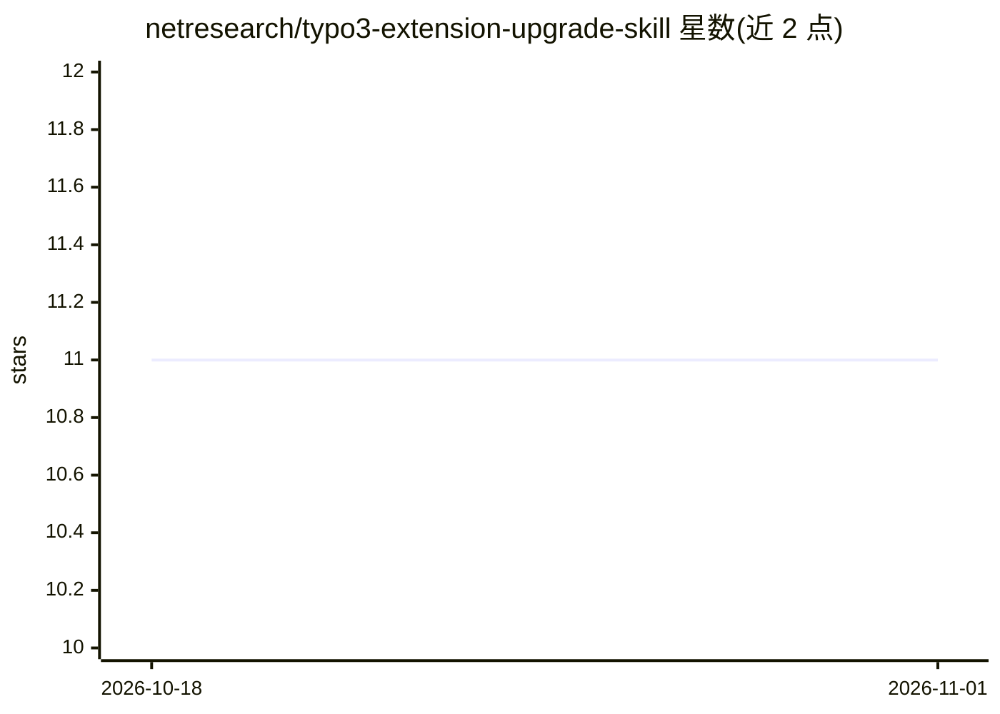

# netresearch/typo3-extension-upgrade-skill

⭐ 11 · Shell · NOASSERTION · 推送 2026-10-30 · [GitHub](https://github.com/netresearch/typo3-extension-upgrade-skill) · 组织维护

**给扩展开发者的 TYPO3 扩展升级 Agent 技能包**

由 Netresearch DTT GmbH 开发的 Agent Skill，遵循 Anthropic 发布的开放技能标准，兼容 Claude Code、Cursor、GitHub Copilot 等平台。内容为指导 TYPO3 扩展从 v7 升级至 v13/v14 LTS 的程序性知识，覆盖 Extension Scanner 诊断、Rector/Fractor 自动迁移、PHPStan 静态分析与 PHPUnit 测试 setup，并附 45 项废弃 API 检查的 shell 脚本。明确不适用于 TYPO3 项目安装升级、核心升级或实例迁移。提供 marketplace、git clone、npx、Composer 等多种安装方式，采用 split licensing。

## 筛选速览

| 维度 | 判定 | 备注 |
|---|---|---|
| AI 角色 | `ai-knowledge` | 知识聚合/清单类 |
| 许可风险 | `none` | NOASSERTION |
| 部署形态 | `library` | 以包/库形式分发 |
| 模型依赖 | — | README 未给出锁定关系 |
| 硬件要求 | — | 无带数字的原话,不猜 |
| 安装摩擦 | `low` | 无编译、无系统依赖或容器化 |
| 成熟度 | — | 结构信号不足 |

## 能力要点

- 覆盖 v7→v13 的文档化升级路径，v13→v14 处于监控状态
- 集成 Extension Scanner、Rector、Fractor、PHPStan、PHPUnit 的升级流程
- 45 项废弃 API 检查脚本（scan-deprecations.sh，依赖 Bash 与 GNU grep）
- 兼容 Claude Code、Cursor、GitHub Copilot 等 Agent Skills 规范平台

## 适用场景

- 把第三方或自研 TYPO3 扩展升级到新 LTS 版本
- 让 AI agent 诊断并修复扩展中的废弃 API 用法
- 同时兼容 TYPO3 12 与 13 的双版本适配

## 场景标签

`编码 Agent` · 领域:编码与开发

## 证据(README 行号)

> L9: This is an **Agent Skill** following the open standard originally developed by Anthropic and released for cross-plat
> L17: > Skills are portable packages of procedural knowledge that work across any AI agent supporting the Agent Skills sp
> L21: This skill guides extension developers through upgrading TYPO3 extensions (third-party or custom) to newer TYPO3 LT

## 星数曲线

2026-10-18 11 → 2026-11-01 11（+0）

---
*卡片 v1 · prompt 1.4 · 生成 2026-11-01 · 置信度 high · 依据 README sha `89d0fab094ad` · [字段定义](../../DATASET.md)*
