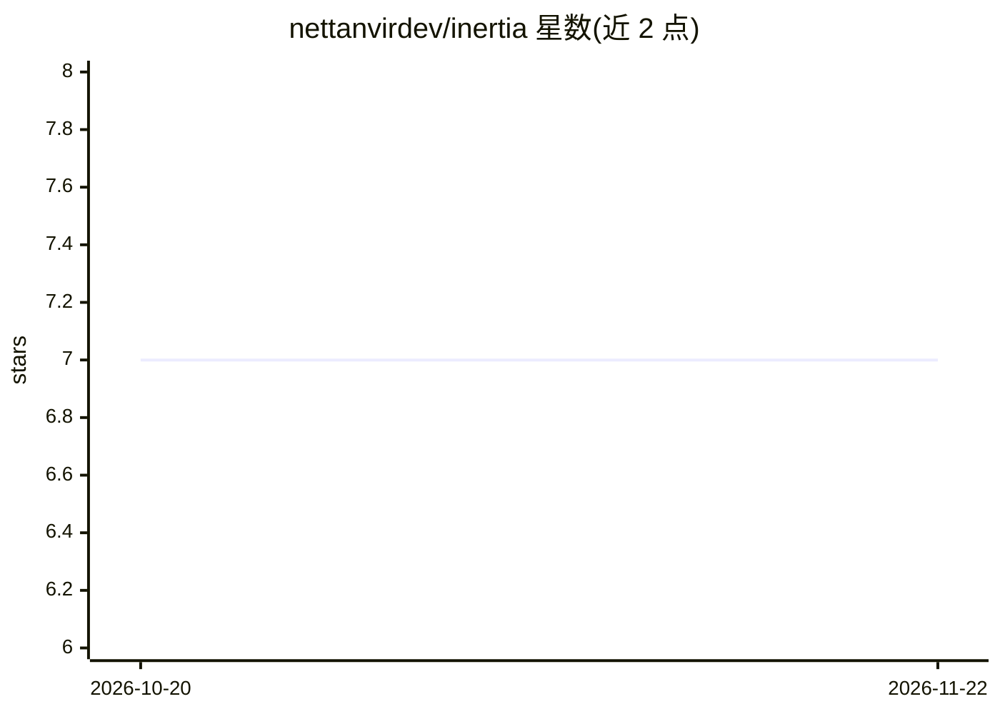

# nettanvirdev/inertia

⭐ 7 · Rust · MIT · 推送 2026-11-04 · [GitHub](https://github.com/nettanvirdev/inertia) · [官网](https://nettanvir.dev/inertia-ai) · 个人维护

**本地桌面 AI agent 工作区：聊天、工具、沙箱与记忆**

基于 Tauri 2（Rust）与 React 的 Windows 桌面应用，用于在本机运行 AI agent：聊天支持 Chat/Plan/Autonomous/Agent Group 四种模式，agent 可读写文件、执行命令、驱动浏览器、委派子 agent，并调用 MCP 服务器与 OpenAPI 工具。沙箱支持 Docker/Daytona，带 noVNC 可视桌面。对话、agent、例行任务与记忆均为所选工作区文件夹中的纯文本文件。无账号无服务器，用户自带模型提供商与 API key；权限系统按工具/命令/路径控制 allow/ask/deny。

## 筛选速览

| 维度 | 判定 | 备注 |
|---|---|---|
| AI 角色 | `ai-native` | 本体是模型或模型工具 |
| 许可风险 | `permissive` | MIT |
| 部署形态 | `desktop` | 安装包/桌面程序 |
| 模型依赖 | local-ok | 支持本地模型 |
| 硬件要求 | — | 无带数字的原话,不猜 |
| 安装摩擦 | `low` | 无编译、无系统依赖或容器化 |
| 成熟度 | — | 结构信号不足 |

## 能力要点

- 四种聊天模式（Chat/Plan/Autonomous/Agent Group）与子 agent 委派、并行后台团队
- Anthropic 原生支持，兼容 OpenAI chat-completions API 的任意提供商（含 Ollama 本地服务）
- MCP（stdio/HTTP）、OpenAPI 工具、Composio 与 Claude Code 兼容生命周期钩子
- Docker/Daytona 沙箱带 noVNC 实时桌面；cron/interval 例行任务与跨会话记忆

## 适用场景

- 在本机让 agent 读写文件、跑 shell 命令并操作浏览器完成任务
- 把不信任的任务放进 Docker/Daytona 沙箱并实时观看 agent 操作桌面
- 用 cron/interval 例行任务让 agent 在应用运行期间无人值守执行
- 用自建/本地模型（如 Ollama）与自己的 API key 运行 agent 工作区

## 场景标签

`编码 Agent` `AI 助手` `浏览器自动化` · 领域:效率与自动化

## 证据(README 行号)

> L16: inertia-ai (the app itself is called Inertia) is a desktop app for working with AI agents on your own machine. You
> L35: - **Any model provider**: Anthropic natively, and anything that speaks the
> L53: - **Computers**: Docker or Daytona sandboxes with a desktop the agent can see

## 星数曲线

2026-10-20 7 → 2026-11-22 7（+0）

---
*卡片 v1 · prompt 1.4 · 生成 2026-11-20 · 置信度 high · 依据 README sha `e6245f7216d2` · [字段定义](../../DATASET.md)*
