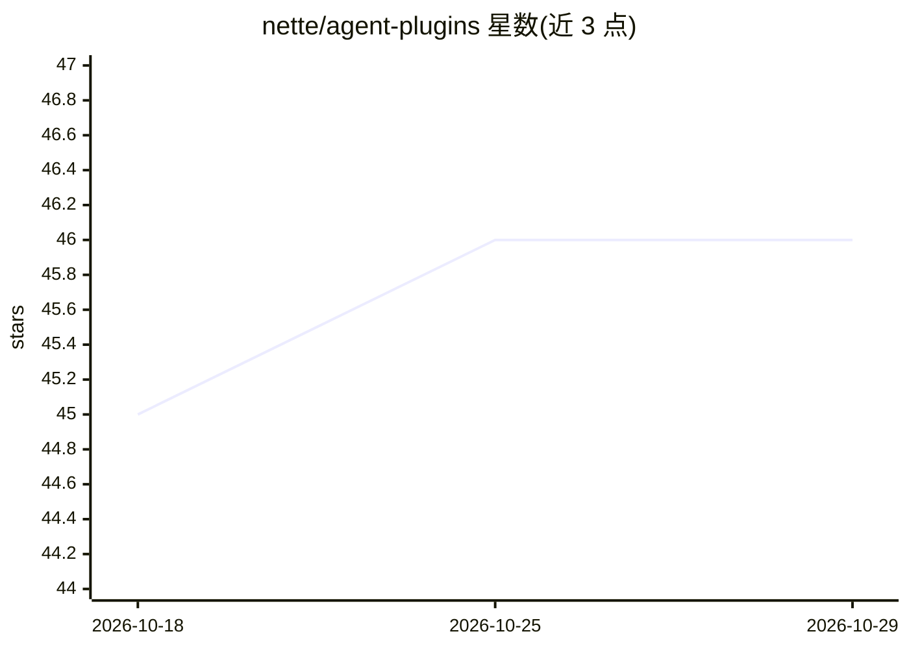

# nette/agent-plugins

⭐ 46 · PHP · MIT · 推送 2026-10-25 · [GitHub](https://github.com/nette/agent-plugins) · [官网](https://ai.nette.org/en/agent-plugins) · 组织维护

**面向 Claude Code 与 Codex 的 Nette 框架开发插件集**

Nette 官方为 Claude Code 和 Codex 提供的插件包，两客户端共用同一套 skills、hooks 与项目配置。含四个插件：nette（应用开发最佳实践与规范，覆盖架构、数据库、表单、Latte、NEON 等 13 类技能）、nette-lint（编辑后自动校验 PHP/Latte/NEON/JSON/JS 并将错误回传给助手）、nette-dev（框架贡献者规范）、php-fixer（基于 DressCode 的自动代码风格修复）。技能自带 Nette 文档页面供按需读取；hooks 需环境有 PHP 8.0+，技能本身无需 PHP。通过 /plugin 或 codex plugin 命令安装。

## 筛选速览

| 维度 | 判定 | 备注 |
|---|---|---|
| AI 角色 | `ai-ecosystem` | LLM/agent 周边工具 |
| 许可风险 | `permissive` | MIT |
| 部署形态 | `None` |  |
| 模型依赖 | locked-api |  |
| 硬件要求 | — | 无带数字的原话,不猜 |
| 安装摩擦 | `low` | 无编译、无系统依赖或容器化 |
| 成熟度 | — | 结构信号不足 |

## 能力要点

- 同一套 skills/hooks 同时支持 Claude Code 与 Codex
- nette-lint 在编辑后自动校验 PHP/Latte/NEON/JSON/JS 并回传错误
- 技能附带 Nette 文档页面，助手按需读取细节
- 通过 .nette-claude.json 配置排除路径与 JSONC 识别规则

## 适用场景

- 在 Claude Code 或 Codex 中开发 Nette 框架应用时获得最佳实践指导
- 编辑文件后自动做语法与风格校验，把错误反馈给 AI 助手修正
- 参与 Nette 框架本身开发时遵循贡献规范

## 场景标签

`编码 Agent` · 领域:编码与开发

## 证据(README 行号)

> L1: # Nette Plugins for Claude Code and Codex
> L3: Plugins for Claude Code and Codex. They provide knowledge of the Nette Framework ecosystem, including best practices
> L79: Hooks run after Claude Code `Edit`/`Write` and Codex `apply_patch` calls. Codex patches may change multiple files: 

## 星数曲线

2026-10-18 45 → 2026-10-29 46（+1）

---
*卡片 v1 · prompt 1.4 · 生成 2026-10-25 · 置信度 high · 依据 README sha `1a3a83bd8c60` · [字段定义](../../DATASET.md)*
