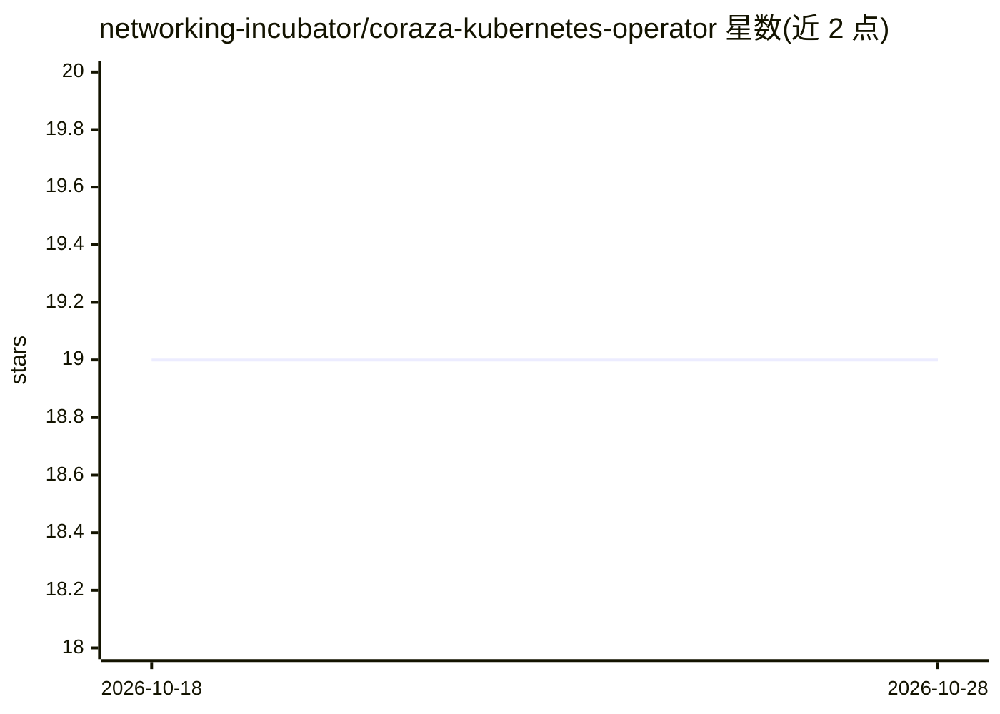

# networking-incubator/coraza-kubernetes-operator

⭐ 19 · Go · Apache-2.0 · 推送 2026-10-27 · [GitHub](https://github.com/networking-incubator/coraza-kubernetes-operator) · 组织维护

**Kubernetes 网关的 WAF 管理算子：声明式部署 Coraza 防火墙**

Coraza Kubernetes Operator（CKO）在 Kubernetes 集群上以声明式方式管理 Web 应用防火墙：提供 Engine、RuleSet、RuleSource、RuleData 四个 API，防火墙引擎以 Coraza 实现，挂载到 Gateway API 的 Gateway 上执行规则。规则经编译校验后由缓存服务器下发，Engine 轮询以实现运行中规则热更新。支持 Kubernetes v1.32+ 与 OpenShift v4.20+，集成方式目前仅 Istio+WASM（ingress Gateway）。仅支持 Seclang 规则，不随附规则包，规则需用户自备；RuleSet 限同命名空间。README 无 AI 相关功能描述。

## 筛选速览

| 维度 | 判定 | 备注 |
|---|---|---|
| AI 角色 | `ai-enhanced` | 去掉 AI 部分产品仍成立 |
| 许可风险 | `permissive` | Apache-2.0 |
| 部署形态 | `None` |  |
| 模型依赖 | — | README 未给出锁定关系 |
| 硬件要求 | — | 无带数字的原话,不猜 |
| 安装摩擦 | `low` | 无编译、无系统依赖或容器化 |
| 成熟度 | — | 结构信号不足 |

## 能力要点

- Engine/RuleSet/RuleSource/RuleData 四个声明式 API 管理 WAF 实例与规则
- 以 Coraza 为防火墙引擎，兼容 ModSecurity Seclang 规则
- 规则编译缓存下发，Engine 轮询支持运行中规则实时更新
- 支持 Kubernetes v1.32+ / OpenShift v4.20+，集成 Istio+WASM

## 适用场景

- 在 Kubernetes Gateway 上为入口流量挂载 WAF 防护
- 以 GitOps 方式声明式管理 Seclang 规则集并热更新
- 在 Istio ingress Gateway 场景以 WASM 模块加载 Coraza

## 场景标签

 · 领域:云原生/网络安全

## 证据(README 行号)

> L6: [Web Application Firewall (WAF)] support for [Kubernetes] [Gateways].
> L19: [Coraza] is used as the firewall engine.

## 星数曲线

2026-10-18 19 → 2026-10-28 19（+0）

---
*卡片 v1 · prompt 1.4 · 生成 2026-10-28 · 置信度 low · 依据 README sha `2d515e6a19e0` · [字段定义](../../DATASET.md)*
