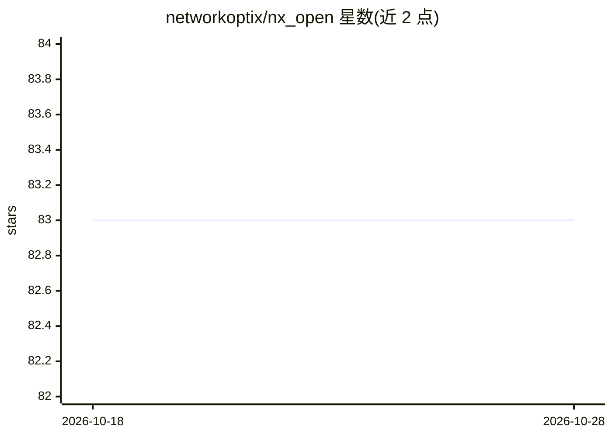

# networkoptix/nx_open

⭐ 83 · C++ · 推送 2026-10-28 · [GitHub](https://github.com/networkoptix/nx_open) · [官网](https://networkoptix.com) · 组织维护

**Nx 视频管理平台桌面客户端的开源组件，可自行构建 VMS 桌面端**

Network Optix 开源的 Meta Platform 组件仓库，包含用于构建 Powered-by-Nx 产品（含 Nx Witness VMS）的源码与规格说明。当前可构建的主要组件是 VMS 桌面客户端，另含可独立使用的 Nx Kit 库。以 MPL 2.0 许可（另有说明的文件除外）。通过 CMake/Ninja/Conan 工具链在 Windows/Linux/macOS 上从源码构建，支持交叉编译与自定义品牌包；客户端只能连接到源码不公开的兼容 VMS Server，兼容性仅在同一 commit 的发布版本间保证。

## 筛选速览

| 维度 | 判定 | 备注 |
|---|---|---|
| AI 角色 | `ai-enhanced` | 去掉 AI 部分产品仍成立 |
| 许可风险 | `none` | — |
| 部署形态 | `desktop` | 安装包/桌面程序 |
| 模型依赖 | — | README 未给出锁定关系 |
| 硬件要求 | — | 无带数字的原话,不猜 |
| 安装摩擦 | `medium` | 含编译或系统依赖之一 |
| 成熟度 | — | 结构信号不足 |

## 能力要点

- 提供 VMS 桌面客户端完整源码，支持 Windows/Linux/macOS 构建与 ARM 交叉编译
- Nx Kit 库（artifacts/nx_kit/）可独立使用
- 支持通过 Customization Package 自定义客户端品牌
- 支持可执行文件签名（Windows）与自动更新机制说明

## 适用场景

- 从源码构建并定制 Nx VMS 桌面客户端
- 基于 Nx Kit 库开发独立组件
- 为自有品牌生成定制化 VMS 客户端

## 场景标签

 · 领域:视频监控/视频管理平台

## 证据(README 行号)

> L7: This repository `nx_open` contains **Network Optix Meta Platform open-source components** - the
> L11: Currently, the main VMS component which can be built from this repository is the Desktop Client.

## 星数曲线

2026-10-18 83 → 2026-10-28 83（+0）

---
*卡片 v1 · prompt 1.4 · 生成 2026-10-24 · 置信度 mid · 依据 README sha `c57249fd9ae5` · [字段定义](../../DATASET.md)*
