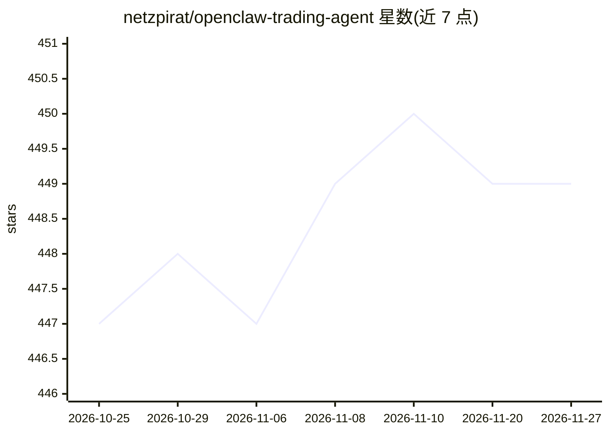

# netzpirat/openclaw-trading-agent

⭐ 449 · Python · 推送 2026-11-16 · [GitHub](https://github.com/netzpirat/openclaw-trading-agent) · [官网](https://agentvps.io) · 个人维护

**LLM 驱动的加密货币交易 agent，接入 Hyperliquid 自动执行交易**

基于 LLM 的交易 agent：通过 TAAPI 读取实时技术指标（EMA/RSI 等），由多模型生成交易决策，在 Hyperliquid 去中心化交易所自动执行，内置止盈/止损风控与可配置间隔的持续交易循环，并提供 /diary 与 /logs 本地 API 记录交易日志。使用 Python + Poetry 运行，需配置 TAAPI、Hyperliquid 私钥与 OpenRouter API key。README 声明项目为实验性且未审计，不保证盈利。

## 筛选速览

| 维度 | 判定 | 备注 |
|---|---|---|
| AI 角色 | `ai-native` | 本体是模型或模型工具 |
| 许可风险 | `none` | — |
| 部署形态 | `None` |  |
| 模型依赖 | locked-api |  |
| 硬件要求 | — | 无带数字的原话,不猜 |
| 安装摩擦 | `low` | 无编译、无系统依赖或容器化 |
| 成熟度 | `idea` | |

## 能力要点

- LLM 驱动的交易决策，支持多模型与 tool-calling 动态查询指标
- 在 Hyperliquid 上自动执行交易，内置 TP/SL 风控
- 通过 TAAPI 获取实时技术分析（EMA/RSI/自定义指标）
- 支持 EigenCloud TEE 部署以安全处理密钥

## 适用场景

- 让 LLM agent 7x24 监控行情并自动在 Hyperliquid 下单
- 实验不同的 LLM 模型与策略参数进行交易策略试验
- 通过本地 API 查看交易日记与运行日志

## 场景标签

`金融量化` · 领域:学习与行业

## 证据(README 行号)

> L3: OpenClaw is an **AI-powered trading agent** that uses LLMs to analyze real-time market data, generate trading decisi
> L11: * ⚡ Automated trade execution on Hyperliquid

## 星数曲线

2026-10-25 447 → 2026-11-27 449（+2）

---
*卡片 v1 · prompt 1.4 · 生成 2026-11-25 · 置信度 high · 依据 README sha `92b8f7a441cf` · [字段定义](../../DATASET.md)*
