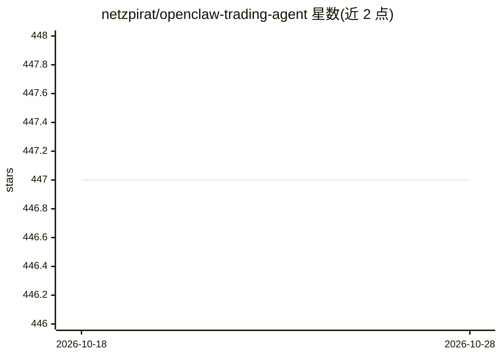

# netzpirat/openclaw-trading-agent

⭐ 448 · Python · 推送 2026-05-03 · [GitHub](https://github.com/netzpirat/openclaw-trading-agent) · [官网](https://agentvps.io) · 个人维护

**面向 Hyperliquid 的 LLM 驱动自动化交易 Agent**

用 LLM 分析实时行情并生成交易决策、在 Hyperliquid 去中心化交易所自动执行的交易 Agent：通过 TAAPI 获取技术指标（EMA/RSI 等，支持 tool-calling 动态查询），按可配置间隔循环监控，内置止盈/止损风控逻辑，附带本地轻量 API 查看日志与交易记录。LLM 经 OpenRouter 接入（多模型），可部署到 EigenCloud 的 TEE 环境做密钥安全管理。README 声明项目为实验性且未经审计，不保证盈利。

## 筛选速览

| 维度 | 判定 | 备注 |
|---|---|---|
| AI 角色 | `ai-native` | 本体是模型或模型工具 |
| 许可风险 | `none` | — |
| 部署形态 | `None` |  |
| 模型依赖 | locked-api |  |
| 硬件要求 | — | 无带数字的原话,不猜 |
| 安装摩擦 | `low` | 无编译、无系统依赖或容器化 |
| 成熟度 | `idea` | |

## 能力要点

- LLM 生成交易决策，经 OpenRouter 多模型接入
- 通过 TAAPI 获取技术指标并支持 tool-calling 动态查询
- 自动执行 Hyperliquid 交易，含 TP/SL 风控逻辑
- 可部署至 EigenCloud TEE 环境管理密钥

## 适用场景

- 在 Hyperliquid 上跑自动化加密货币交易循环
- 用不同 LLM 模型做交易决策的策略实验
- 通过本地 API 查看交易日记与运行日志

## 场景标签

`金融量化` · 领域:学习与行业

## 证据(README 行号)

> L3: OpenClaw is an **AI-powered trading agent** that uses LLMs to analyze real-time market data, generate trading decisi
> L9: * 🤖 LLM-driven trading decisions (multi-model support)
> L11: * ⚡ Automated trade execution on Hyperliquid

## 星数曲线

2026-10-18 447 → 2026-10-28 447（+0）

---
*卡片 v1 · prompt 1.4 · 生成 2026-10-21 · 置信度 high · 依据 README sha `ddb243f43bad` · [字段定义](../../DATASET.md)*
