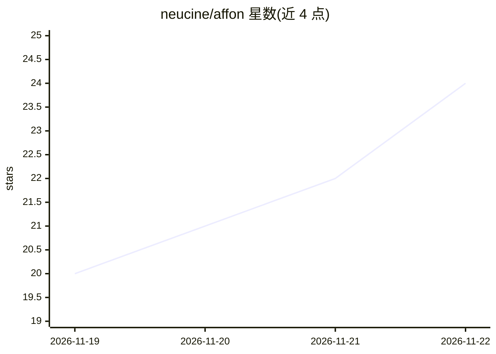

# neucine/affon

⭐ 24 · TypeScript · MPL-2.0 · 推送 2026-11-18 · [GitHub](https://github.com/neucine/affon) · [官网](https://affon.ai) · 个人维护 · 中文 README

**面向科研计算与机器学习的 TypeScript 运行时**

以 Program/Session 为核心的 TypeScript 运行时：用户以声明式方式定义计算的输入、参数与操作，可检查定义、派生训练步骤并在受支持设备上运行。模块覆盖神经网络层工厂、SGD/Adam/AdamW 优化器、数据集管线、checkpoint 持久化与遥测诊断，并带第一方包（模型、Hugging Face 集成、ONNX 执行）与解码器语言模型示例。CPU 与 Metal 为主要验证目标，CUDA 测试覆盖较少；不以 PyTorch API 全兼容为目标，README 自述为实验性项目。

## 筛选速览

| 维度 | 判定 | 备注 |
|---|---|---|
| AI 角色 | `ai-native` | 本体是模型或模型工具 |
| 许可风险 | `permissive` | MPL-2.0 |
| 部署形态 | `None` |  |
| 模型依赖 | — | README 未给出锁定关系 |
| 硬件要求 | — | 无带数字的原话,不猜 |
| 安装摩擦 | `medium` | 含编译或系统依赖之一 |
| 成熟度 | `idea` | |

## 能力要点

- 声明式计算 Program：类型化张量角色、显式状态、微分与编译
- CPU、Metal、CUDA 设备放置与 kernel 能力感知 lowering
- SGD/Adam/AdamW 不可变优化器描述符与 optimize(model, loss, optimizer) 组合
- 第一方包支持模型、Hugging Face 集成、tokenizer 与 ONNX 执行

## 适用场景

- 在 TypeScript 环境中构建并训练张量/神经网络程序
- 运行表格与文本数据管线（含分词窗口）
- 在 macOS Metal 或 Linux CUDA 设备上执行计算

## 场景标签

`模型训练` · 领域:训练与推理

## 证据(README 行号)

> L7:  A TypeScript runtime for scientific computing and machine learning
> L9: Affon is a TypeScript runtime for scientific computing and machine learning.
> L99: - **Declarative compute Programs** with typed tensor roles, explicit state, differentiation, optimization, and comp

## 星数曲线

2026-11-19 20 → 2026-11-22 24（+4）

---
*卡片 v1 · prompt 1.4 · 生成 2026-11-19 · 置信度 mid · 依据 README sha `ed6b89b9fc7a` · [字段定义](../../DATASET.md)*
