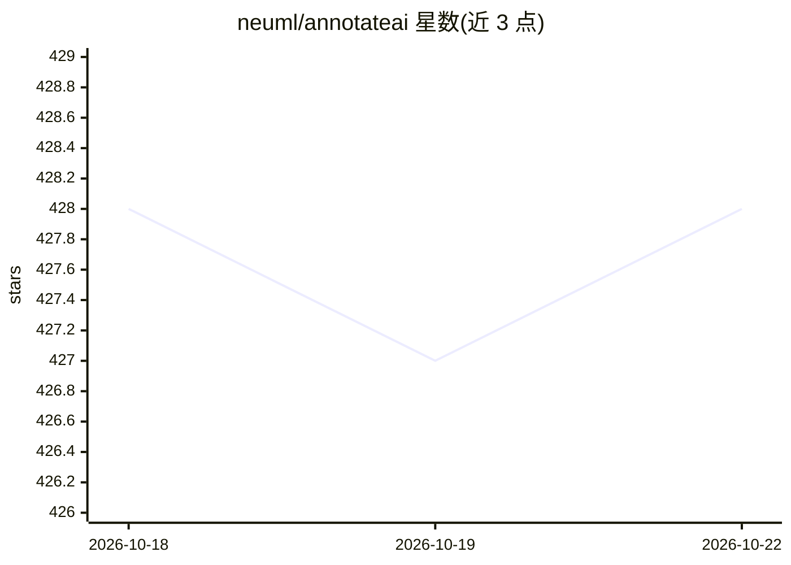

# neuml/annotateai

⭐ 429 · Python · Apache-2.0 · 推送 2026-05-05 · [GitHub](https://github.com/neuml/annotateai) · 个人维护

**用 LLM 自动为论文标注关键概念的 Python 工具**

annotateai 是基于 txtai 的论文标注工具：读取 PDF 后自动提取标题与关键概念，逐页定位并生成简洁主题，再在论文中高亮标注对应章节，供读者阅读时获取上下文。通过单一 Annotate 实例调用，支持任何 txtai 支持的 LLM（如 GPT/Claude API、llama.cpp 本地模型），可用 keywords 参数指定固定概念集以批量处理。适用医学与科学论文（arXiv、PubMed、bioRxiv、medRxiv），pip 安装，另有 Docker Web 应用。

## 筛选速览

| 维度 | 判定 | 备注 |
|---|---|---|
| AI 角色 | `ai-native` | 本体是模型或模型工具 |
| 许可风险 | `permissive` | Apache-2.0 |
| 部署形态 | `self-host` | docker 或自建部署 |
| 模型依赖 | local-ok | 支持本地模型 |
| 硬件要求 | — | 无带数字的原话,不猜 |
| 安装摩擦 | `low` | 无编译、无系统依赖或容器化 |
| 成熟度 | — | 结构信号不足 |

## 能力要点

- 一行调用完成读取 PDF→提取关键概念→高亮标注全流程
- 支持任何 txtai 支持的 LLM（API 服务与 llama.cpp 本地模型）
- keywords 参数支持固定概念集的批量论文处理
- 提供 Docker Web 应用，可经 ENV 配置 LLM

## 适用场景

- 阅读医学/科学论文时快速获得关键章节标注
- 批量文献综述中按指定概念集统一标注论文
- 通过 Docker 部署网页版进行论文标注

## 场景标签

`科研工具` · 领域:学习与行业

## 证据(README 行号)

> L18: `annotateai` automatically annotates papers using Large Language Models (LLMs). While LLMs can summarize papers, se
> L56: The primary input parameter is the path to the LLM. This project is backed by txtai and it supports any txtai-suppo

## 星数曲线

2026-10-18 428 → 2026-10-22 428（+0）

---
*卡片 v1 · prompt 1.4 · 生成 2026-10-21 · 置信度 high · 依据 README sha `9571ac45448d` · [字段定义](../../DATASET.md)*
