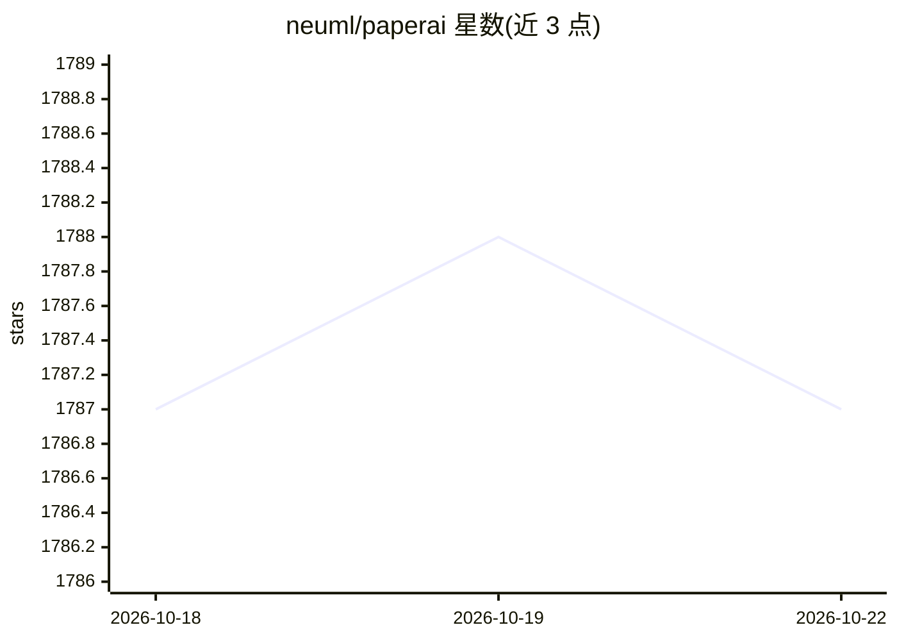

# neuml/paperai

⭐ 1,787 · Python · Apache-2.0 · 推送 2026-07-14 · [GitHub](https://github.com/neuml/paperai) · 组织维护

**面向医学/科学论文的 AI 检索与批量报告生成应用**

基于 txtai 的论文研究应用：对 paperetl 构建的文献数据库建立嵌入索引，提供终端 shell 与 query 入口做向量/关键词/混合检索；核心机制是 YAML 报告配置文件，通过 LLM 提示与 RAG 管道对每篇匹配文章生成动态列，批量产出 Markdown、CSV 报告或在原 PDF 上标注答案。面向医学与科研人员处理大规模文献库，需 Python 3.10+，支持 pip 安装与 Docker 镜像构建。

## 筛选速览

| 维度 | 判定 | 备注 |
|---|---|---|
| AI 角色 | `ai-native` | 本体是模型或模型工具 |
| 许可风险 | `permissive` | Apache-2.0 |
| 部署形态 | `self-host` | docker 或自建部署 |
| 模型依赖 | — | README 未给出锁定关系 |
| 硬件要求 | — | 无带数字的原话,不猜 |
| 安装摩擦 | `low` | 无编译、无系统依赖或容器化 |
| 成熟度 | — | 结构信号不足 |

## 能力要点

- 配置文件驱动的批量 LLM/RAG 报告生成（动态列）
- 报告输出 Markdown/CSV 及 PDF 原文标注三种格式
- 基于 txtai 嵌入索引 + SQLite 文章库 + LLM 的 RAG 架构
- 提供终端 shell、单次查询与报告三个入口

## 适用场景

- 对医学文献库批量提问并生成带出处的报告
- 研究特定疾病时筛选最相关论文并提取答案
- 在原始 PDF 上标注答案出处以便核对

## 场景标签

`RAG` `科研工具` `语义搜索` · 领域:知识与检索

## 证据(README 行号)

> L22: `paperai` is an AI application for medical and scientific papers.
> L26: ⚡ Supercharge research tasks with AI-driven report generation. A `paperai` application goes through repositories of
> L188: `paperai` is a combination of a txtai embeddings index, a SQLite database with the articles and an LLM. These comp

## 星数曲线

2026-10-18 1,787 → 2026-10-22 1,787（+0）

---
*卡片 v1 · prompt 1.4 · 生成 2026-10-21 · 置信度 high · 依据 README sha `45cb9ad179b4` · [字段定义](../../DATASET.md)*
