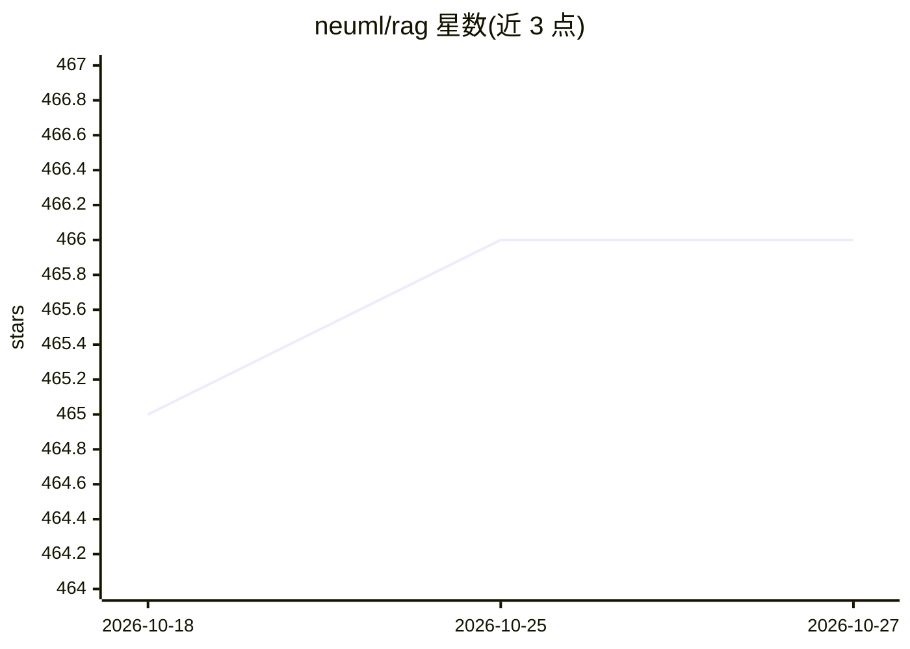

# neuml/rag

⭐ 466 · Python · Apache-2.0 · 推送 2026-06-05 · [GitHub](https://github.com/neuml/rag) · 个人维护

**基于 txtai 的 RAG 问答应用：向量与图检索生成回答**

由 txtai 作者维护的 Streamlit 应用，提供向量 RAG 与 Graph RAG 两类检索增强生成：向量检索取 top N 结果注入 LLM 提示词，或通过图路径遍历构建上下文。支持通过 # 前缀上传文件/URL/文本加入索引，默认使用 Qwen3-4B 与 txtai-wikipedia-slim 嵌入库，可通过环境变量切换 LLM（含 Ollama、OpenAI API）与嵌入索引。以 Docker 容器或 Python 虚拟环境两种方式运行。

## 筛选速览

| 维度 | 判定 | 备注 |
|---|---|---|
| AI 角色 | `ai-native` | 本体是模型或模型工具 |
| 许可风险 | `permissive` | Apache-2.0 |
| 部署形态 | `self-host` | docker 或自建部署 |
| 模型依赖 | local-ok | 支持本地模型 |
| 硬件要求 | — | 无带数字的原话,不猜 |
| 安装摩擦 | `low` | 无编译、无系统依赖或容器化 |
| 成熟度 | — | 结构信号不足 |

## 能力要点

- 支持向量 RAG 与 Graph RAG（图路径遍历、gq: 图查询扩展及组合模式）
- # 前缀直接上传文件/URL/文本入索引
- 环境变量配置 LLM/嵌入库/持久化等参数，含 Ollama 与 OpenAI 接入示例
- 查询响应附带对应图谱可视化

## 适用场景

- 在自己的数据上做检索增强问答
- 用图路径遍历方式探索知识图谱并生成回答
- 上传文档建立本地嵌入索引后提问

## 场景标签

`RAG` `文档问答` · 领域:知识与检索

## 证据(README 行号)

> L13: This project is a Retrieval Augmented Generation (RAG) Streamlit application backed by txtai.
> L19: - Vector RAG: Context supplied via a vector search query

## 星数曲线

2026-10-18 465 → 2026-10-27 466（+1）

---
*卡片 v1 · prompt 1.4 · 生成 2026-10-21 · 置信度 high · 依据 README sha `554515d44039` · [字段定义](../../DATASET.md)*
