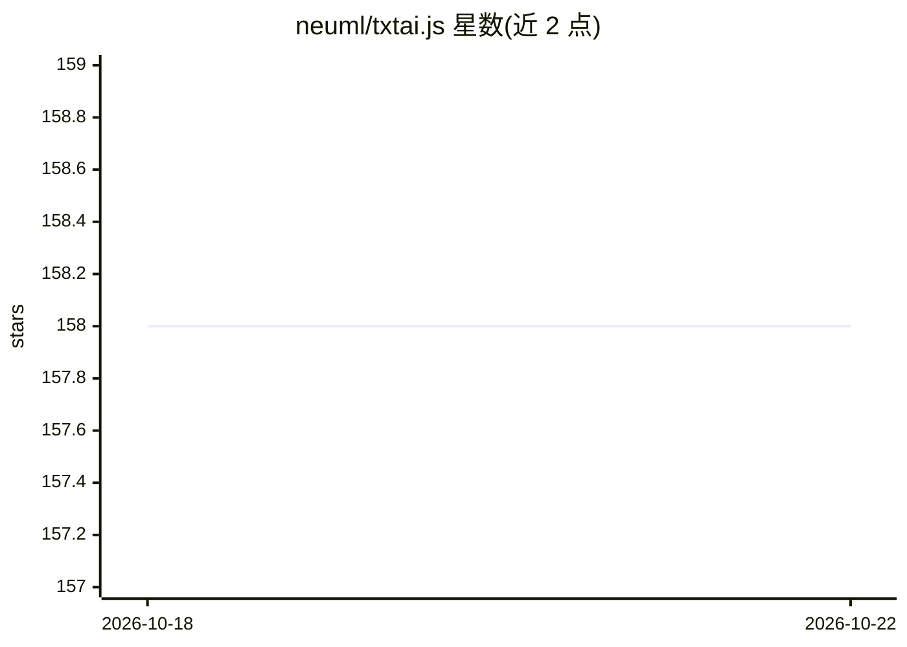

# neuml/txtai.js

⭐ 158 · JavaScript · Apache-2.0 · 推送 2026-10-06 · [GitHub](https://github.com/neuml/txtai.js) · 组织维护

**txtai 的 JavaScript 客户端：连接 txtai API 实例**

为 txtai（语义搜索、LLM 编排与语言模型工作流的一体化 AI 框架）提供 JavaScript 绑定，通过连接已运行的 txtai API 实例，使 JavaScript/Node 环境调用其能力。以 npm 包 txtai 形式分发，示例目录含入门、抽取式问答、零样本分类、流水线与工作流等示例，需先自行启动 txtai API 服务方可使用。

## 筛选速览

| 维度 | 判定 | 备注 |
|---|---|---|
| AI 角色 | `ai-ecosystem` | LLM/agent 周边工具 |
| 许可风险 | `permissive` | Apache-2.0 |
| 部署形态 | `library` | 以包/库形式分发 |
| 模型依赖 | — | README 未给出锁定关系 |
| 硬件要求 | — | 无带数字的原话,不猜 |
| 安装摩擦 | `low` | 无编译、无系统依赖或容器化 |
| 成熟度 | — | 结构信号不足 |

## 能力要点

- 提供 txtai API 的 JavaScript 绑定
- npm 安装（npm install txtai）
- 附抽取式问答、零样本分类、流水线与工作流等示例

## 适用场景

- 在 Node/JavaScript 项目中调用 txtai 的语义搜索与问答能力
- 跟随示例学习 txtai 各功能模块的用法

## 场景标签

`语义搜索` · 领域:知识与检索

## 证据(README 行号)

> L16: txtai is an all-in-one AI framework for semantic search, LLM orchestration and language model workflows.
> L18: This repository contains JavaScript bindings for the txtai API.
> L35: txtai.js connects to a txtai api instance. See this link for details on how to start a new api instance.

## 星数曲线

2026-10-18 158 → 2026-10-22 158（+0）

---
*卡片 v1 · prompt 1.4 · 生成 2026-10-22 · 置信度 high · 依据 README sha `12ebf116c8e8` · [字段定义](../../DATASET.md)*
