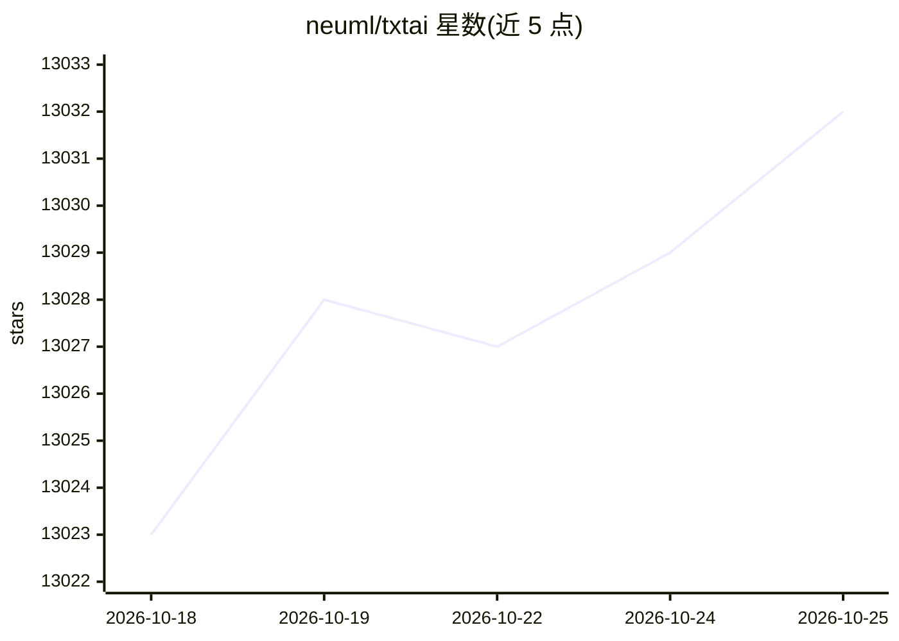

# neuml/txtai

⭐ 13,032 · Python · Apache-2.0 · 推送 2026-10-22 · [GitHub](https://github.com/neuml/txtai) · [官网](https://neuml.github.io/txtai) · 组织维护

**Python 全栈 AI 框架：语义搜索、LLM 编排与语言模型工作流**

以嵌入数据库为核心组件（向量索引、图网络与关系数据库的结合）的 Python AI 框架，面向构建 LLM 应用的开发者。提供向量搜索、多模态嵌入、语言模型驱动的管线（提示、问答、转录、翻译、摘要等）、连接管线的 workflow，以及基于 smolagents 构建的自主 agent；支持 RAG、Web 与 MCP API，并有 JavaScript/Java/Rust/Go 绑定。基于 Python 3.11+、Hugging Face Transformers、Sentence Transformers 和 FastAPI 构建，Apache 2.0 许可，可本地运行或容器编排扩展。附带 70+ 示例 notebook。

## 筛选速览

| 维度 | 判定 | 备注 |
|---|---|---|
| AI 角色 | `ai-ecosystem` | LLM/agent 周边工具 |
| 许可风险 | `permissive` | Apache-2.0 |
| 部署形态 | `library` | 以包/库形式分发 |
| 模型依赖 | — | README 未给出锁定关系 |
| 硬件要求 | — | 无带数字的原话,不猜 |
| 安装摩擦 | `low` | 无编译、无系统依赖或容器化 |
| 成熟度 | — | 结构信号不足 |

## 能力要点

- 嵌入数据库融合稀疏/稠密向量索引、图网络与关系数据库
- agent 基于 smolagents，支持 Hugging Face、llama.cpp、OpenAI/Claude/AWS Bedrock（经 LiteLLM）
- 管线覆盖提示、问答、标注、转录、翻译、摘要等任务
- 提供 Web 与 MCP API，含 JavaScript/Java/Rust/Go 绑定

## 适用场景

- 构建语义搜索与问答知识库应用
- 搭建 RAG 流水线实现与数据对话
- 将多个语言模型任务串联成自动化工作流
- 构建连接嵌入库与管线的自主 agent

## 场景标签

`RAG` `语义搜索` `向量数据库` `工作流自动化` · 领域:效率与自动化

## 证据(README 行号)

> L22: txtai is an all-in-one AI framework for semantic search, LLM orchestration and language model workflows.
> L31: Build autonomous agents, retrieval augmented generation (RAG) processes, multi-model workflows and more.
> L39: - 🤖 Agents that intelligently connect embeddings, pipelines, workflows and other agents together to autonomously so

## 星数曲线

2026-10-18 13,023 → 2026-10-25 13,032（+9）

---
*卡片 v1 · prompt 1.4 · 生成 2026-10-20 · 置信度 high · 依据 README sha `286747554da8` · [字段定义](../../DATASET.md)*
