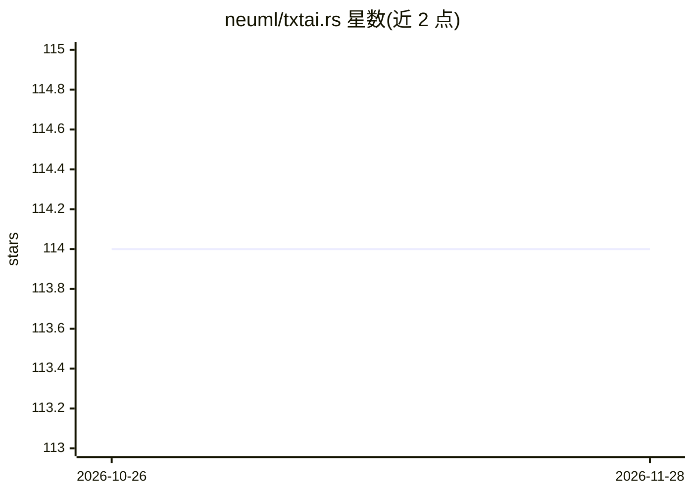

# neuml/txtai.rs

⭐ 114 · Rust · Apache-2.0 · 推送 2026-11-23 · [GitHub](https://github.com/neuml/txtai.rs) · 组织维护

**给 Rust 开发者接入 txtai API 的官方客户端绑定**

txtai（语义搜索、LLM 编排与语言模型工作流框架）的 Rust 客户端绑定库，通过 Cargo.toml 以 crate 形式提供。客户端连接到运行中的 txtai API 实例，依赖 tokio 进行异步 IO。仓库附带示例目录，覆盖语义搜索概览、抽取式问答、零样本分类标注与流水线工作流，示例通过 git clone 后以 cargo run 运行。

## 筛选速览

| 维度 | 判定 | 备注 |
|---|---|---|
| AI 角色 | `ai-ecosystem` | LLM/agent 周边工具 |
| 许可风险 | `permissive` | Apache-2.0 |
| 部署形态 | `None` |  |
| 模型依赖 | — | README 未给出锁定关系 |
| 硬件要求 | — | 无带数字的原话,不猜 |
| 安装摩擦 | `low` | 无编译、无系统依赖或容器化 |
| 成熟度 | — | 结构信号不足 |

## 能力要点

- 为 txtai API 提供 Rust 绑定（crate 版本 9.15）
- 基于 tokio 的异步 IO
- 示例覆盖抽取式问答与零样本分类等场景

## 适用场景

- 在 Rust 项目中调用 txtai 的语义搜索 API
- 用 Rust 客户端运行问答与零样本分类示例
- 将 txtai 工作流接入 Rust 服务端

## 场景标签

`语义搜索` · 领域:知识与检索

## 证据(README 行号)

> L18: This repository contains Rust bindings for the txtai API.
> L42: txtai.rs connects to a txtai api instance. See this link for details on how to start a new api instance.

## 星数曲线

2026-10-26 114 → 2026-11-28 114（+0）

---
*卡片 v1 · prompt 1.4 · 生成 2026-11-28 · 置信度 high · 依据 README sha `38ba4297d938` · [字段定义](../../DATASET.md)*
