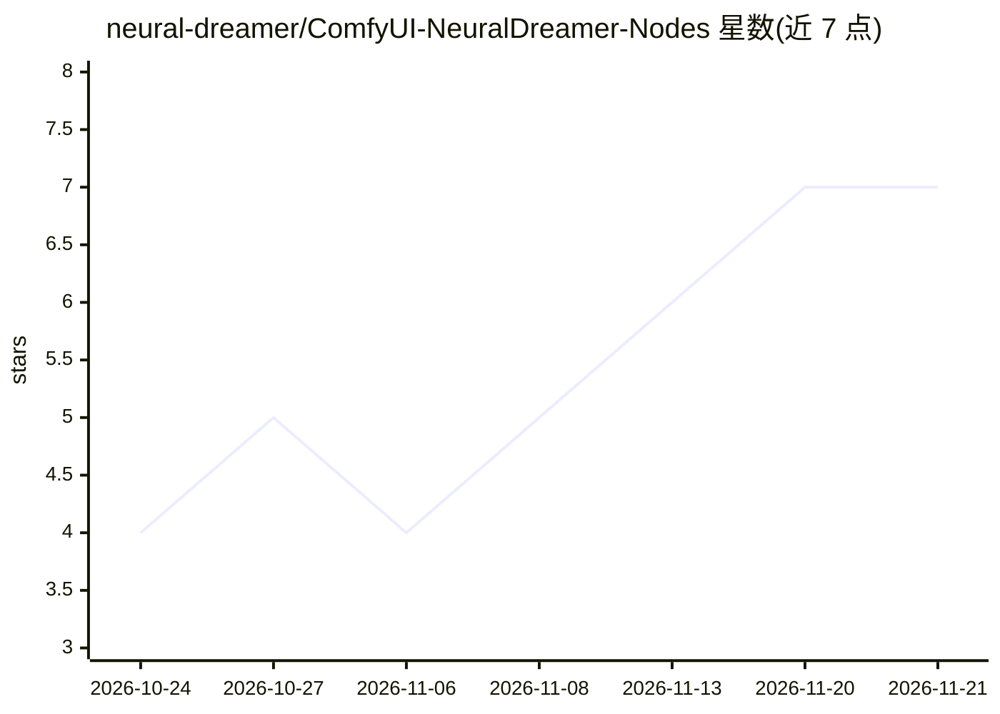

# neural-dreamer/ComfyUI-NeuralDreamer-Nodes

⭐ 7 · Python · MIT · 推送 2026-11-10 · [GitHub](https://github.com/neural-dreamer/ComfyUI-NeuralDreamer-Nodes) · 个人维护

**ComfyUI 自定义节点集：变体挑选、实时预览、提示词与参数管理**

为 ComfyUI 提供的第三方节点集合，按 Variant/Utils/Prompt/Loaders/Images/Parameters/Logic 分类，共 22 个节点。核心机制是 ND_PARAMS 参数线：通过 Pack/Unpack 节点把多个值打包在一条连线上传输。功能覆盖图像批次变体的缩略图选择与放大分支触发、采样过程实时预览（latent2rgb 或 taesd 解码）、角色/服装/姿势/构图提示词构建、LoRA 栈管理、批量图像装载与逻辑旁路控制。安装为 git clone 到 custom_nodes 目录，无需额外 Python 依赖。

## 筛选速览

| 维度 | 判定 | 备注 |
|---|---|---|
| AI 角色 | `ai-ecosystem` | LLM/agent 周边工具 |
| 许可风险 | `permissive` | MIT |
| 部署形态 | `None` |  |
| 模型依赖 | — | README 未给出锁定关系 |
| 硬件要求 | — | 无带数字的原话,不猜 |
| 安装摩擦 | `low` | 无编译、无系统依赖或容器化 |
| 成熟度 | — | 结构信号不足 |

## 能力要点

- ND_PARAMS 单线参数打包/解包机制，最多一进一出
- 变体选择节点支持实时采样预览与可选的 Upscale 按钮（本身不做放大）
- LoRA 栈节点支持图片/视频预览画廊、NSFW 过滤与强度调节
- 一组逻辑节点实现按节点/按分组的旁路控制

## 适用场景

- 在 ComfyUI 工作流中对比并挑选图像批次中的变体
- 构建结构化的角色与姿势提示词
- 管理带预览画廊的 LoRA 组合
- 用旁路与开关节点控制工作流分支

## 场景标签

`图像生成` · 领域:内容生成

## 证据(README 行号)

> L3: Custom nodes for ComfyUI by Neural Dreamer.
> L50: Nodes that take or give several values have at most one input and one output, both of type `ND_PARAMS` (a parameter

## 星数曲线

2026-10-24 4 → 2026-11-21 7（+3）

---
*卡片 v1 · prompt 1.4 · 生成 2026-11-20 · 置信度 mid · 依据 README sha `2b871a1c911e` · [字段定义](../../DATASET.md)*
