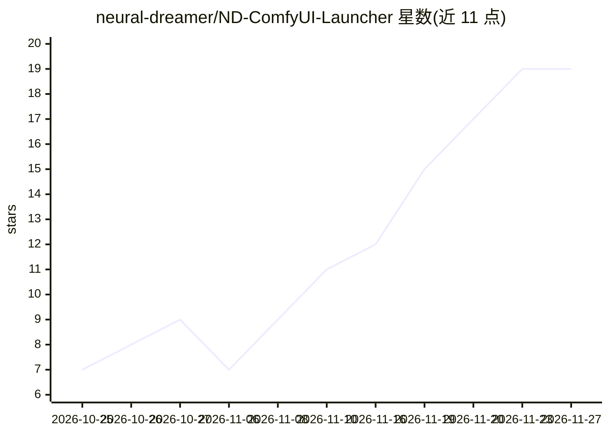

# neural-dreamer/ND-ComfyUI-Launcher

⭐ 19 · Python · GPL-3.0 · 推送 2026-11-17 · [GitHub](https://github.com/neural-dreamer/ND-ComfyUI-Launcher) · 组织维护

**Windows 便携版 ComfyUI 的一窗口启动器：预设、更新、节点与模型管理**

面向 Windows 的桌面启动器（PySide6），管理任意便携版 ComfyUI 构建：提供启动预设（VRAM 模式、attention 选择、fp8/fp16 等）、窗口内控制台与 GPU 监控、工作流管理（含缺失模型核对、拖入 zip 一并安装节点与模型）、一键更新与节点安装、Hugging Face/Civitai 模型下载（断点续传、SHA-256 校验）、CUDA/ROCm 环境切换、增量备份、构建迁移与 extra_model_paths.yaml 可视化编辑。原为 Neural Dreamer 构建开发，兼容任意便携版构建。源码分发，用户自行一键构建 exe。

## 筛选速览

| 维度 | 判定 | 备注 |
|---|---|---|
| AI 角色 | `ai-ecosystem` | LLM/agent 周边工具 |
| 许可风险 | `viral` | GPL-3.0 |
| 部署形态 | `desktop` | 安装包/桌面程序 |
| 模型依赖 | — | README 未给出锁定关系 |
| 硬件要求 | — | 无带数字的原话,不猜 |
| 安装摩擦 | `medium` | 含编译或系统依赖之一 |
| 成熟度 | — | 结构信号不足 |

## 能力要点

- 5 种启动预设加自定义参数控件（VRAM、attention、fp8/fp16、端口）
- Hugging Face/Civitai 模型下载，16 并行连接、暂停续传、SHA-256 校验
- 增量备份还原点与构建迁移（复制/移动/硬链接/链接）
- CUDA/ROCm 便携环境一键切换（实验性，切换失败自动回滚）

## 适用场景

- 管理多个便携版 ComfyUI 构建的启动、更新与节点
- 从 Hugging Face 或 Civitai 下载模型并断点续传
- 把旧构建的模型、工作流、节点迁移到新构建
- 不写 .bat 参数地切换 VRAM/速度/视频生成等启动预设

## 场景标签

 · 领域:AI 图像生成工具链/桌面工具

## 证据(README 行号)

> L5: **A one-window launcher for any portable ComfyUI build on Windows**
> L15: No more `.bat` files and launch flags to remember. ND Launcher starts ComfyUI with the right settings, updates it a

## 星数曲线

2026-10-25 7 → 2026-11-27 19（+12）

---
*卡片 v1 · prompt 1.4 · 生成 2026-11-18 · 置信度 high · 依据 README sha `b38401a6ef7d` · [字段定义](../../DATASET.md)*
