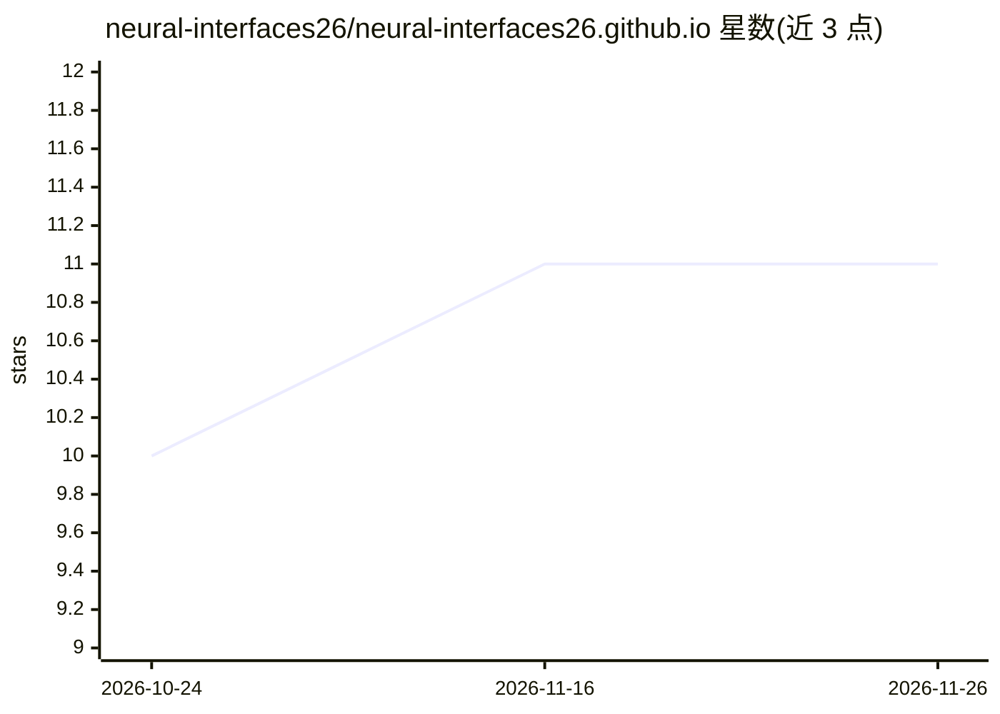

# neural-interfaces26/neural-interfaces26.github.io

⭐ 11 · HTML · 推送 2026-11-21 · [GitHub](https://github.com/neural-interfaces26/neural-interfaces26.github.io) · [官网](https://neural-interfaces26.github.io/) · 组织维护

**NeurIPS 2026 神经接口挑战赛的静态网站仓库**

本仓库包含 Neural Interfaces 2026 竞赛网站的静态页面，由 HTML、CSS、JavaScript 与图片文件构成，无需 Jekyll 或其他构建系统。README 提供本地预览流程：仅需 Git 与 Python 3，运行 scripts/serve.sh 后在浏览器访问本地端口即可预览，修改后刷新页面生效；另附发布前日历检查脚本 calendar-check.py 与基于 git 的发布前校验步骤。仓库主题标签指向 EEG、EMG、睡眠与 BCI 四赛道的脑解码基准。

## 筛选速览

| 维度 | 判定 | 备注 |
|---|---|---|
| AI 角色 | `ai-knowledge` | 知识聚合/清单类 |
| 许可风险 | `none` | — |
| 部署形态 | `None` |  |
| 模型依赖 | — | README 未给出锁定关系 |
| 硬件要求 | — | 无带数字的原话,不猜 |
| 安装摩擦 | `low` | 无编译、无系统依赖或容器化 |
| 成熟度 | — | 结构信号不足 |

## 能力要点

- 静态网站无需构建系统，仅用 Git 与 Python 3 即可本地运行
- scripts/serve.sh 支持自定义端口预览
- 提供 calendar-check.py 联动竞赛仓库做日历校验
- 普通文件修改无需重启服务器

## 适用场景

- 本地预览和编辑竞赛官网页面
- 发布前核对提交内容与日历改动
- 参与 EEG/EMG/睡眠/BCI 脑解码基准竞赛时查阅赛事信息

## 场景标签

 · 领域:科研竞赛/基准测试

## 证据(README 行号)

> L1: # Neural Interfaces 2026 website
> L3: This repository contains the static website for Neural Interfaces 2026. The site is made of HTML, CSS, JavaScript, a

## 星数曲线

2026-10-24 10 → 2026-11-26 11（+1）

---
*卡片 v1 · prompt 1.4 · 生成 2026-11-18 · 置信度 mid · 依据 README sha `a7809988f416` · [字段定义](../../DATASET.md)*
