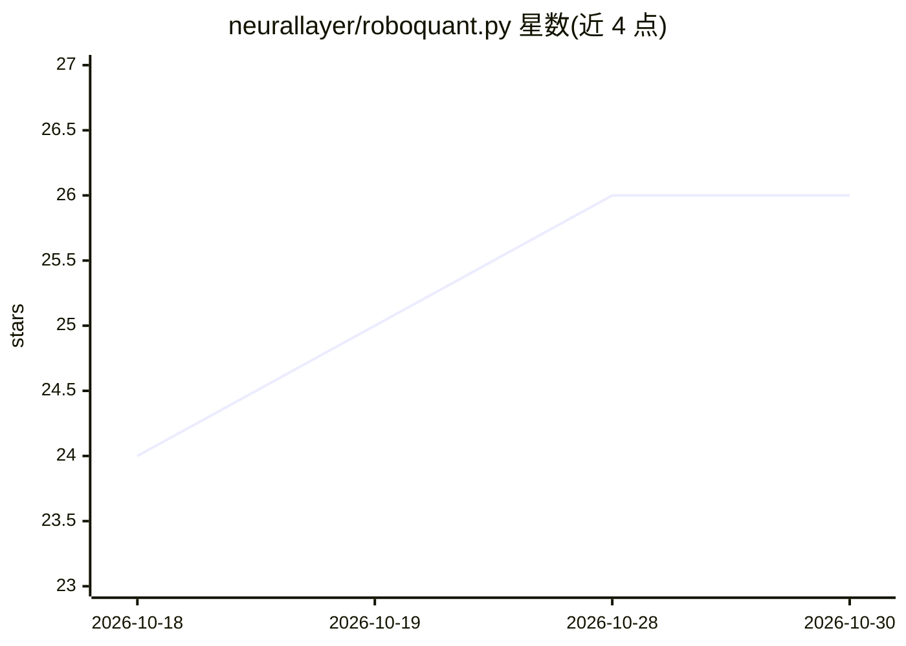

# neurallayer/roboquant.py

⭐ 26 · Python · Apache-2.0 · 推送 2026-10-05 · [GitHub](https://github.com/neurallayer/roboquant.py) · [官网](https://neurallayer.github.io/roboquant.py/) · 个人维护

**Python 开源算法交易平台：回测与实盘交易策略开发**

用 Python 编写的开源算法交易平台，面向个人散户与机构交易者，提供回测与实盘交易、多资产（股票、期权、外汇、加密货币）多币种交易、CSV/Yahoo Finance/Alpaca 及多家加密交易所的行情数据源、TaLib 指标策略与大于内存的数据流处理。AI/ML 策略通过可选依赖（PyTorch、SB3）支持。需 Python 3.12+，以 pip/uv/conda 安装，Apache 2.0 许可，作者声明不承担实盘交易损失责任且未受金融监管注册。

## 筛选速览

| 维度 | 判定 | 备注 |
|---|---|---|
| AI 角色 | `ai-enhanced` | 去掉 AI 部分产品仍成立 |
| 许可风险 | `permissive` | Apache-2.0 |
| 部署形态 | `library` | 以包/库形式分发 |
| 模型依赖 | — | README 未给出锁定关系 |
| 硬件要求 | — | 无带数字的原话,不猜 |
| 安装摩擦 | `low` | 无编译、无系统依赖或容器化 |
| 成熟度 | — | 结构信号不足 |

## 能力要点

- 回测与实盘交易
- 多资产多币种：股票、期权、外汇、加密货币
- CSV、Yahoo Finance、Alpaca 与多家加密交易所数据源
- 可选安装 roboquant[ai] 以使用基于 PyTorch 和 SB3 的 AI 策略

## 适用场景

- 对股票、加密货币等资产组合运行策略回测
- 开发并部署全自动交易策略到实盘
- 接入 IBKR、Alpaca 等券商或交易所进行程序化交易

## 场景标签

`金融量化` · 领域:学习与行业

## 证据(README 行号)

> L9: Roboquant is an open-source algorithmic trading platform written in Python. It is flexible, user-friendly
> L52: # AI based strategies using PyTorch and SB3

## 星数曲线

2026-10-18 24 → 2026-10-30 26（+2）

---
*卡片 v1 · prompt 1.4 · 生成 2026-10-27 · 置信度 high · 依据 README sha `e4ab7e111006` · [字段定义](../../DATASET.md)*
