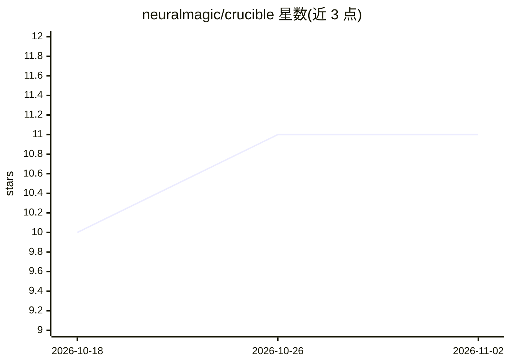

# neuralmagic/crucible

⭐ 11 · Rust · Apache-2.0 · 推送 2026-10-29 · [GitHub](https://github.com/neuralmagic/crucible) · [官网](https://neuralmagic.github.io/crucible/) · 组织维护

**以 Starlark 声明任务图运行 agent 工作流与自动优化的引擎**

用 Rust 编写的 agentic 工作流引擎：以 Starlark 声明任务图，任务可以是 agent 轮次、命令、评测或引擎决策，编译为静态计划后在单一 Git 工作区内按依赖序执行，受成本/时间预算约束。提供两条通道：playbook 单次执行，autoresearch 将图放入优化循环（agent 提改动、judge 度量、保留或回滚）。配套控制平面含 Postgres、React UI、OIDC、Vault 与 MCP server，以 ghcr 镜像发布。领域代码可用任意语言，仅需 crucible.toml 与可执行命令。限制：任务集在编译期固定，图内任务级动态性不支持。

## 筛选速览

| 维度 | 判定 | 备注 |
|---|---|---|
| AI 角色 | `ai-ecosystem` | LLM/agent 周边工具 |
| 许可风险 | `permissive` | Apache-2.0 |
| 部署形态 | `desktop` | 安装包/桌面程序 |
| 模型依赖 | — | README 未给出锁定关系 |
| 硬件要求 | — | 无带数字的原话,不猜 |
| 安装摩擦 | `medium` | 含编译或系统依赖之一 |
| 成熟度 | — | 结构信号不足 |

## 能力要点

- Starlark 声明任务图，编译为静态计划后在单一 Git 工作区执行
- autoresearch keep-or-discard 优化循环：提议→度量→保留或回滚
- route() 运行时分支与 revise 有界返工循环
- budget.usd 成本预算作为终止条件；自带控制平面（Postgres/OIDC/Vault/MCP）

## 适用场景

- 在无人值守循环中让 agent 反复改进代码仓库并用 judge 打分取舍
- 以声明式图编排 agent、命令与评测任务并控制运行成本
- 团队通过控制平面与 UI 管理多集群上的 playbook 运行

## 场景标签

`工作流自动化` `Agent 框架` · 领域:Agent 开发

## 证据(README 行号)

> L5: Crucible runs agent work as a declared graph of tasks. You write the graph in Starlark. A
> L18: - An **autoresearch** run puts the graph in an optimization loop. An agent proposes a change,
> L109: - **An agent turn runs in a sandbox, not a graph pod.** The agent backend owns the sandbox

## 星数曲线

2026-10-18 10 → 2026-11-02 11（+1）

---
*卡片 v1 · prompt 1.4 · 生成 2026-11-01 · 置信度 high · 依据 README sha `c127f68d4a32` · [字段定义](../../DATASET.md)*
