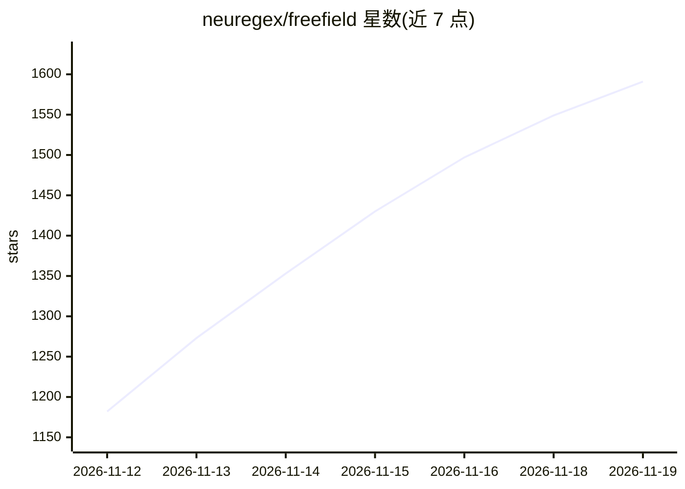

# neuregex/freefield

⭐ 1,591 · Python · MIT · 推送 2026-11-18 · [GitHub](https://github.com/neuregex/freefield) · [官网](https://youtu.be/N7mv2v3Txeo) · 个人维护

**开源 Higgsfield 复刻：120 个图像/视频/VFX/音频生成应用**

基于 ComfyUI 与 Comfy SDK 重建 Higgsfield 布局的创作工作室，含 120 个应用（图像生成、编辑、视频、VFX、音频、角色替换、唇形同步等），全部使用开放权重模型，无 API 或合作方节点。每个应用是 apps/ 下一个文件夹，含 app.json 清单与 API 格式工作流，Web UI、运行器、模型下载、VRAM 图与测试均由清单派生。可在 Modal 或自有 GPU 上运行，表内标注各应用在 24 GB 显卡的显存需求，部分应用需 Modal（峰值 24-44 GB）。

## 筛选速览

| 维度 | 判定 | 备注 |
|---|---|---|
| AI 角色 | `ai-native` | 本体是模型或模型工具 |
| 许可风险 | `permissive` | MIT |
| 部署形态 | `None` |  |
| 模型依赖 | — | README 未给出锁定关系 |
| 硬件要求 | — | 无带数字的原话,不猜 |
| 安装摩擦 | `low` | 无编译、无系统依赖或容器化 |
| 成熟度 | — | 结构信号不足 |

## 能力要点

- 120 个应用，每个为 apps/ 下的文件夹（app.json + ComfyUI 工作流）
- 全部模型开放权重，标注 Hugging Face 仓库、大小与许可
- 支持 Modal 或自有 ComfyUI/GPU 运行，各应用附显存需求
- 每个示例均为实验室真实 GPU 运行结果，附耗时与峰值显存

## 适用场景

- 在自托管环境中生成图像、视频与音频内容
- 复用 Higgsfield 风格的创作工作流而无需闭源 API
- 从任意 ComfyUI 工作流导入并新增应用

## 场景标签

`图像生成` `视频生成` `语音合成` · 领域:内容生成

## 证据(README 行号)

> L9: Image, video, VFX and audio apps in a studio laid out like Higgsfield's, each one a ComfyUI workflow on open weights
> L21: Freefield rebuilds Higgsfield's creative apps (image, video, VFX, audio) on top of ComfyUI and the Comfy SDK.
> L39: |Open weights|No API or partner nodes. Every model is a file you download, listed in its app's `app.json` with its 

## 星数曲线

2026-11-12 1,182 → 2026-11-19 1,591（+409）

---
*卡片 v1 · prompt 1.4 · 生成 2026-11-17 · 置信度 high · 依据 README sha `5a1c91749493` · [字段定义](../../DATASET.md)*
