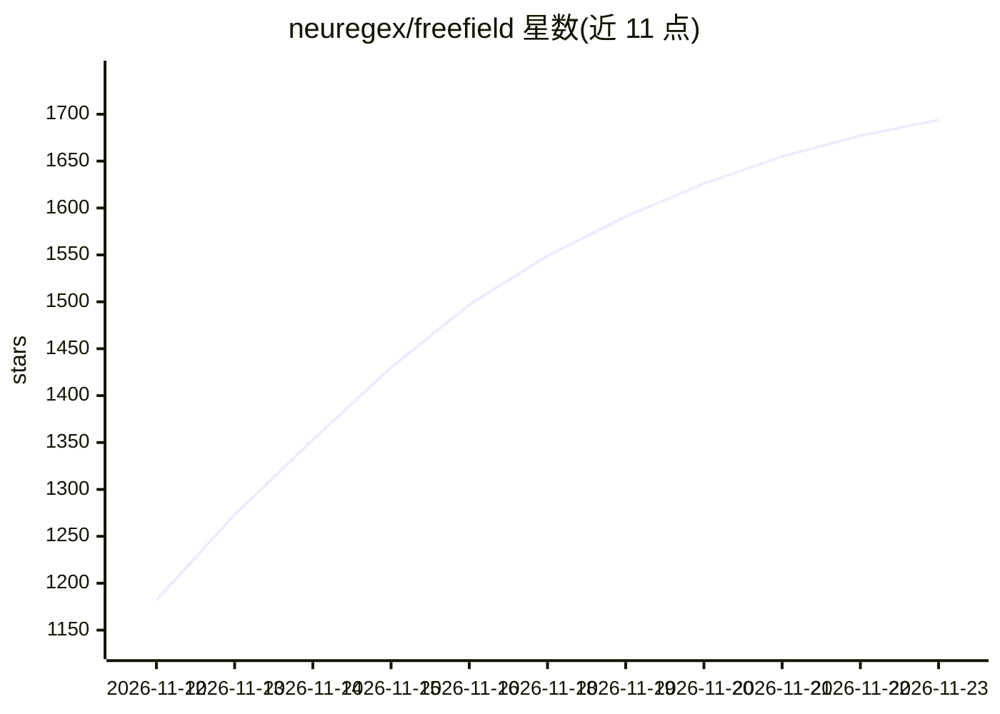

# neuregex/freefield

⭐ 1,694 · Python · MIT · 推送 2026-11-20 · [GitHub](https://github.com/neuregex/freefield) · [官网](https://youtu.be/N7mv2v3Txeo) · 组织维护

**在 ComfyUI 上以开放权重重建 120 个图像/视频/VFX/音频应用**

以 ComfyUI 与 Comfy SDK 为底座重建 Higgsfield 风格的创作应用：每个应用是 apps/ 下含 app.json 清单与 ComfyUI 工作流的文件夹，Web UI、运行器、模型下载与 VRAM 映射均从清单生成，无逐应用代码。120 个应用覆盖图像生成、视频生成、VFX 与音频，全部使用开放权重模型（FLUX 3、LTX-2.5、Wan 2.2、Qwen Image Edit 等）。可经公共模板部署到 RunPod/Vast.ai，可跑在 Modal，也可在 Windows NVIDIA 卡上一行 PowerShell 启动。多数应用适配 24 GB 显存，部分应用标注需 Modal 或更高显存。

## 筛选速览

| 维度 | 判定 | 备注 |
|---|---|---|
| AI 角色 | `ai-native` | 本体是模型或模型工具 |
| 许可风险 | `permissive` | MIT |
| 部署形态 | `self-host` | docker 或自建部署 |
| 模型依赖 | — | README 未给出锁定关系 |
| 硬件要求 | — | 无带数字的原话,不猜 |
| 安装摩擦 | `low` | 无编译、无系统依赖或容器化 |
| 成熟度 | — | 结构信号不足 |

## 能力要点

- 120 个应用均为 ComfyUI 工作流，模型全部开放权重，无 API 或 partner 节点
- 一键部署：RunPod/Vast.ai 公共模板或 Windows 一行 PowerShell 脚本
- 每个应用附带实验室真实 GPU 运行示例及其耗时与峰值 VRAM
- 从任意 ComfyUI 工作流可导入生成新应用

## 适用场景

- 租用 RunPod/Vast.ai GPU 快速跑起图像与视频生成工作流
- 在自己 24 GB 显存的 PC 上运行开放权重的视频/VFX 应用
- 浏览各应用的开放模型清单、许可与 VRAM 占用后选择运行

## 场景标签

`图像生成` `视频生成` · 领域:内容生成

## 证据(README 行号)

> L21: Freefield rebuilds Higgsfield's creative apps (image, video, VFX, audio) on top of ComfyUI and the Comfy SDK.
> L95: |Apps|120: 119 *ready* (39 apps with a workflow of their own, the 5 IC-LoRA apps (`genjutsu`, `reframe`, `sdr-hdr`,

## 星数曲线

2026-11-12 1,182 → 2026-11-23 1,694（+512）

---
*卡片 v1 · prompt 1.4 · 生成 2026-11-23 · 置信度 high · 依据 README sha `acf10d034843` · [字段定义](../../DATASET.md)*
