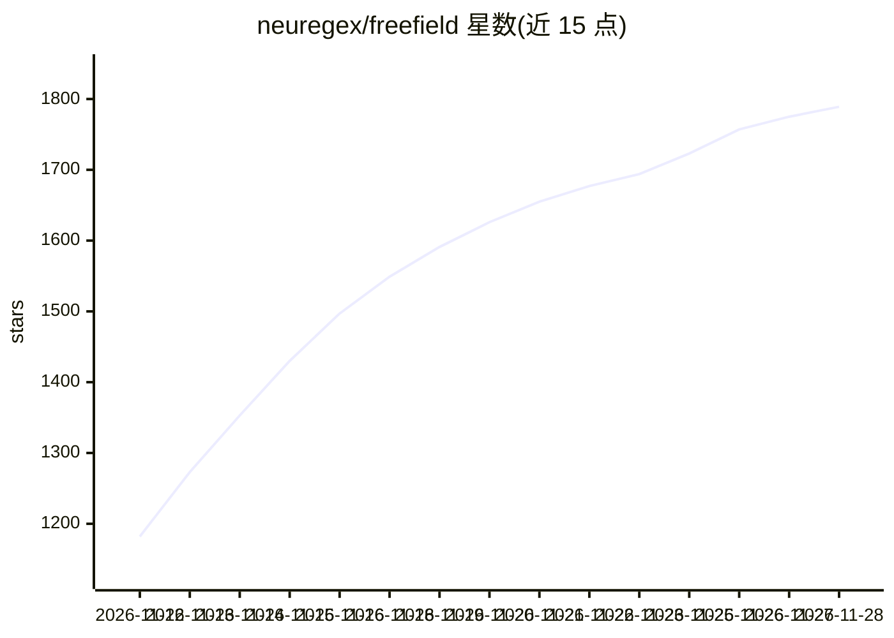

# neuregex/freefield

⭐ 1,789 · Python · MIT · 推送 2026-11-26 · [GitHub](https://github.com/neuregex/freefield) · [官网](https://youtu.be/N7mv2v3Txeo) · 组织维护

**开源版 Higgsfield：ComfyUI 上的 120 个图像/视频/VFX/音频应用**

在 ComfyUI 与 Comfy SDK 之上重建 Higgsfield 风格的创意应用：每个应用是 apps/ 下一个含 app.json 清单与 ComfyUI workflow 的文件夹，Web UI、运行器、模型下载与 VRAM 图均由清单生成，无逐应用代码。所有模型为开放权重文件，无 API 或合作节点。支持在 Modal、按小时租用的 RunPod/Vast.ai GPU 或本地 PC 一行命令运行，官方模板默认包含 64 个应用共 22.9 GB 模型下载。GPU 需 24 GB 以上显存、CUDA 13（不支持 V100）；Web UI 中每个示例附带实验室实跑的耗时与峰值 VRAM。

## 筛选速览

| 维度 | 判定 | 备注 |
|---|---|---|
| AI 角色 | `ai-native` | 本体是模型或模型工具 |
| 许可风险 | `permissive` | MIT |
| 部署形态 | `self-host` | docker 或自建部署 |
| 模型依赖 | — | README 未给出锁定关系 |
| 硬件要求 | — | 无带数字的原话,不猜 |
| 安装摩擦 | `low` | 无编译、无系统依赖或容器化 |
| 成熟度 | — | 结构信号不足 |

## 能力要点

- 120 个应用（119 ready、1 draft），每个是 app.json + ComfyUI workflow 的文件夹
- 全部模型开放权重，app.json 列出 Hugging Face 仓库、大小与许可证
- RunPod/Vast.ai 公共模板一键部署，本地 Windows 一行 PowerShell 启动
- 每个应用示例附带实跑耗时与峰值 VRAM（48 次实验室运行）

## 适用场景

- 不写代码在浏览器里生成带运镜和音效的视频
- 用开放权重模型在自备 GPU 上跑图像/视频/VFX 流水线
- 把任意 ComfyUI workflow 导入为新应用加入工作室

## 场景标签

`图像生成` `视频生成` · 领域:内容生成

## 证据(README 行号)

> L9: Image, video, VFX and audio apps in a studio laid out like Higgsfield's, each one a ComfyUI workflow on open weights
> L21: Freefield rebuilds Higgsfield's creative apps (image, video, VFX, audio) on top of ComfyUI and the Comfy SDK.

## 星数曲线

2026-11-12 1,182 → 2026-11-28 1,789（+607）

---
*卡片 v1 · prompt 1.4 · 生成 2026-11-27 · 置信度 high · 依据 README sha `194c4d8e530f` · [字段定义](../../DATASET.md)*
