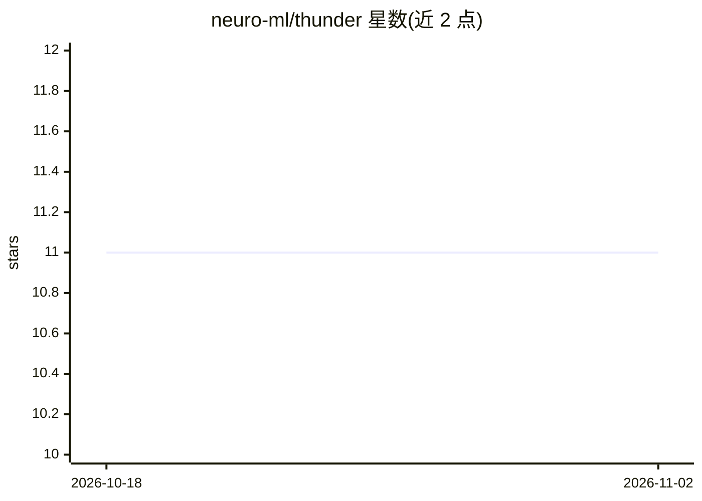

# neuro-ml/thunder

⭐ 11 · Python · MIT · 推送 2025-12-11 · [GitHub](https://github.com/neuro-ml/thunder) · [官网](https://neuro-ml.github.io/thunder/) · 组织维护

**基于 PyTorch Lightning 的深度学习实验框架**

构建在 Lightning 之上的深度学习实验框架，面向使用 PyTorch 的开发者。核心机制是通过配置文件（如 base.config）声明数据集、Lightning 模块与 Trainer，再用 thunder build/run/build-run 命令生成并运行实验，将实验定义与执行流程工具化。以 Python 包形式经 pip 安装，详细功能见其文档。README 较简短，未说明更多限制与细节。

## 筛选速览

| 维度 | 判定 | 备注 |
|---|---|---|
| AI 角色 | `ai-ecosystem` | LLM/agent 周边工具 |
| 许可风险 | `permissive` | MIT |
| 部署形态 | `library` | 以包/库形式分发 |
| 模型依赖 | — | README 未给出锁定关系 |
| 硬件要求 | — | 无带数字的原话,不猜 |
| 安装摩擦 | `low` | 无编译、无系统依赖或容器化 |
| 成熟度 | — | 结构信号不足 |

## 能力要点

- 基于配置文件声明数据集、模块与 Trainer
- thunder build / run / build-run 三条命令生成并执行实验
- 构建于 PyTorch Lightning 之上

## 适用场景

- 用配置文件快速搭建深度学习实验
- 统一管理实验的构建与运行流程

## 场景标签

`MLOps` · 领域:训练与推理

## 证据(README 行号)

> L10: The Deep Learning framework based on Lightning.
> L22: 1. Create a config (e.g. `base.config`):

## 星数曲线

2026-10-18 11 → 2026-11-02 11（+0）

---
*卡片 v1 · prompt 1.4 · 生成 2026-11-01 · 置信度 high · 依据 README sha `90066109089c` · [字段定义](../../DATASET.md)*
