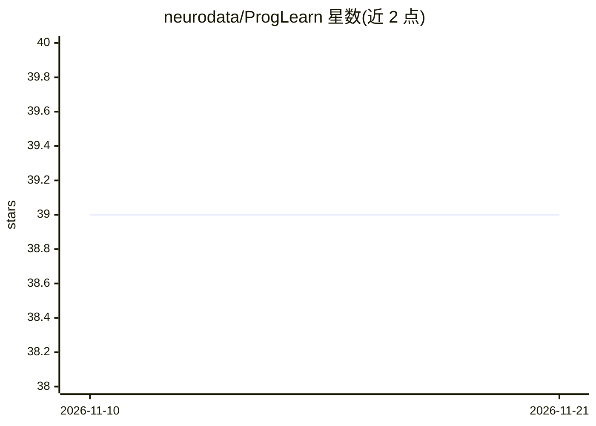

# neurodata/ProgLearn

⭐ 39 · Jupyter Notebook · NOASSERTION · 推送 2026-11-09 · [GitHub](https://github.com/neurodata/ProgLearn) · [官网](https://proglearn.neurodata.io) · 组织维护

**面向研究者的渐进学习算法探索与使用 Python 库**

NeuroData 组开发的渐进学习（Progressive Learning）算法包，提供渐进学习算法的探索与使用接口，主题覆盖分类、持续学习、迁移学习、域适应与随机森林等。要求 Python 3.6+，依赖 tensorflow、scikit-learn、scipy、numpy、joblib，支持 Linux/macOS/Windows。提供安装指南、文档、教程与源码参考链接，README 本身较简略，细节在文档站。

## 筛选速览

| 维度 | 判定 | 备注 |
|---|---|---|
| AI 角色 | `ai-native` | 本体是模型或模型工具 |
| 许可风险 | `none` | NOASSERTION |
| 部署形态 | `library` | 以包/库形式分发 |
| 模型依赖 | — | README 未给出锁定关系 |
| 硬件要求 | — | 无带数字的原话,不猜 |
| 安装摩擦 | `low` | 无编译、无系统依赖或容器化 |
| 成熟度 | — | 结构信号不足 |

## 能力要点

- 渐进学习算法的探索与使用
- 支持 Linux/macOS/Windows 主要平台
- 依赖 tensorflow、scikit-learn、scipy、numpy、joblib
- 提供文档站与教程链接

## 适用场景

- 研究者探索渐进/持续学习算法
- 在分类任务中复用与迁移已学知识
- 作为渐进学习算法的代码参考实现

## 场景标签

 · 领域:机器学习/持续学习

## 证据(README 行号)

> L11: `ProgLearn` (**Prog**ressive **Learn**ing) is a package for exploring and using progressive learning algorithms dev

## 星数曲线

2026-11-10 39 → 2026-11-21 39（+0）

---
*卡片 v1 · prompt 1.4 · 生成 2026-11-18 · 置信度 mid · 依据 README sha `45e3304fe2b1` · [字段定义](../../DATASET.md)*
