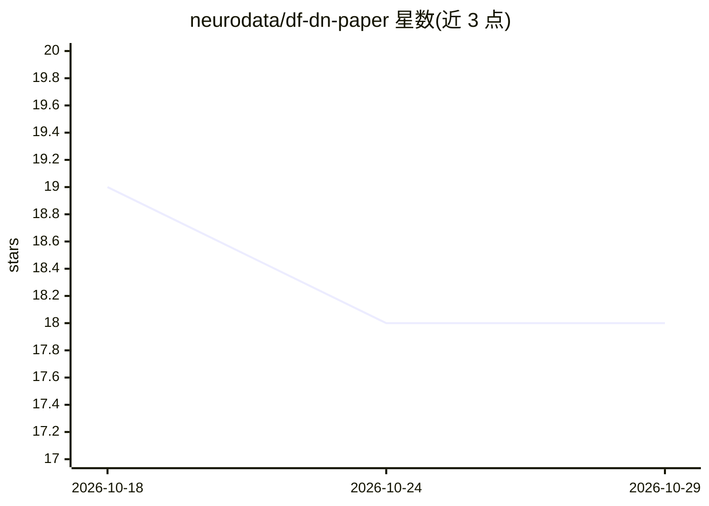

# neurodata/df-dn-paper

⭐ 18 · Jupyter Notebook · NOASSERTION · 推送 2026-08-20 · [GitHub](https://github.com/neurodata/df-dn-paper) · [官网](https://dfdn.neurodata.io) · 组织维护

**决策森林与深度网络在小样本上的对比研究（论文+复现代码）**

neurodata 团维护的研究项目：从概念与实证两个层面对比决策森林（DF）与深度网络（DN）在小样本场景下的分类表现，README 声明为初步工作，更多细节后续提供。仓库托管文档、摘要、复现指南与基准图表（均指向 dfdn.neurodata.io 站点），配置 CircleCI 持续集成、black 代码风格与 Netlify 文档部署。适合关注小样本机器学习模型选型与实验复现的研究人员。

## 筛选速览

| 维度 | 判定 | 备注 |
|---|---|---|
| AI 角色 | `ai-knowledge` | 知识聚合/清单类 |
| 许可风险 | `none` | NOASSERTION |
| 部署形态 | `None` |  |
| 模型依赖 | — | README 未给出锁定关系 |
| 硬件要求 | — | 无带数字的原话,不猜 |
| 安装摩擦 | `low` | 无编译、无系统依赖或容器化 |
| 成熟度 | `idea` | |

## 能力要点

- 决策森林与深度网络的概念与实证对比
- 提供在线文档、摘要、复现指南与基准图表链接
- CircleCI 持续集成与 Netlify 文档部署

## 适用场景

- 了解小样本场景下两类模型的经验对比
- 按复现指南重跑论文基准实验
- 查阅基准图表用于方法选型参考

## 场景标签

`模型评测` · 领域:评测与运维

## 证据(README 行号)

> L1: # When are Deep Networks really better than Decision Forests at small sample sizes, and how?
> L9: **DF/DN:** conceptual & empirical comparisons between **D**ecision **F**orests & **D**eep **N**etworks.

## 星数曲线

2026-10-18 19 → 2026-10-29 18（-1）

---
*卡片 v1 · prompt 1.4 · 生成 2026-10-29 · 置信度 high · 依据 README sha `3f7f91729189` · [字段定义](../../DATASET.md)*
