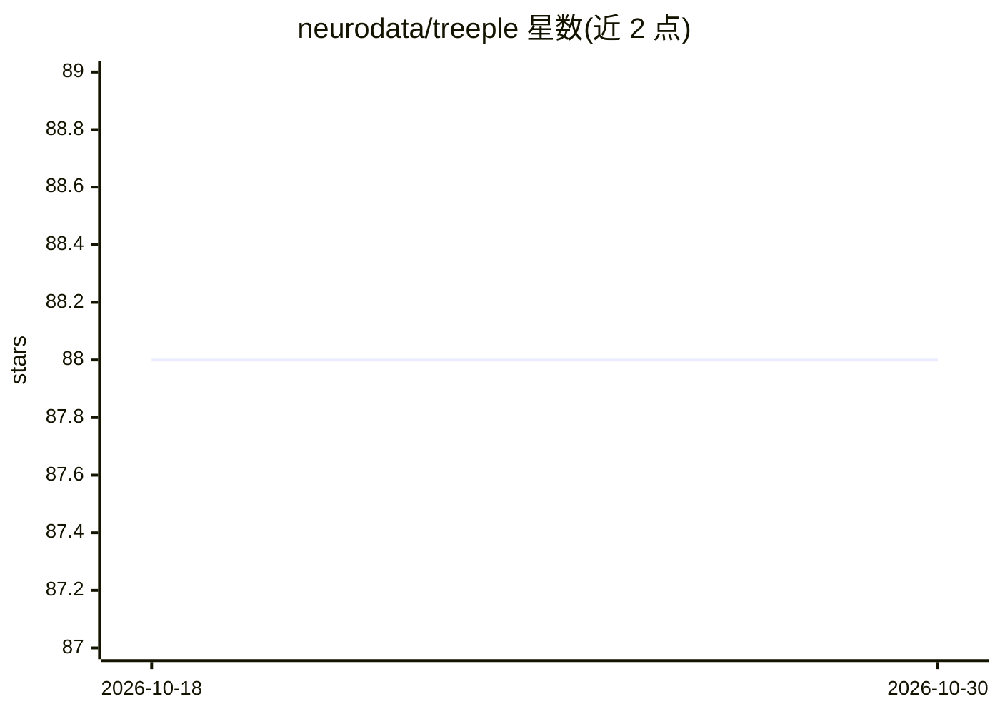

# neurodata/treeple

⭐ 88 · Jupyter Notebook · NOASSERTION · 推送 2026-10-26 · [GitHub](https://github.com/neurodata/treeple) · [官网](https://treeple.ai) · 组织维护

**scikit-learn 兼容的扩展决策树/森林 Python 库**

由 neurodata 维护的机器学习库，提供 scikit-learn 兼容 API 的多种决策树模型：无监督树、斜决策树（oblique trees）、不确定性树、分位数树与因果树，并含 MORF、扩展孤立森林等变体。核心以 Cython 实现，遵循 scikit-learn 树子模块的内部 API 以便扩展新树模型。依赖 Python>=3.9、numpy、scipy、scikit-learn，推荐通过 conda 环境内 pip 安装。原包名 scikit-tree，0.8.0 后更名为 treeple。面向使用或扩展树模型的数据科学开发者。

## 筛选速览

| 维度 | 判定 | 备注 |
|---|---|---|
| AI 角色 | `ai-native` | 本体是模型或模型工具 |
| 许可风险 | `none` | NOASSERTION |
| 部署形态 | `library` | 以包/库形式分发 |
| 模型依赖 | — | README 未给出锁定关系 |
| 硬件要求 | — | 无带数字的原话,不猜 |
| 安装摩擦 | `low` | 无编译、无系统依赖或容器化 |
| 成熟度 | — | 结构信号不足 |

## 能力要点

- 提供无监督树、斜决策树、不确定性树、分位数树、因果树等 scikit-learn 未收录的树模型
- Cython 实现并兼容 scikit-learn 内部树 API，便于扩展自定义树模型
- 支持抽象 API 让用户实现自定义斜切分（oblique splits）

## 适用场景

- 在小样本表格数据、影像、基因组、EEG 等数据上使用树模型
- 需要斜决策树、扩展孤立森林等 scikit-learn 之外的树变体
- 扩展 scikit-learn 决策树 API 实现新的树算法

## 场景标签

 · 领域:机器学习/统计建模

## 证据(README 行号)

> L12: treeple is a scikit-learn compatible API for building state-of-the-art decision trees. These include unsupervised t
> L30: In 2001, Leo Breiman proposed two types of Random Forests. One was known as ``Forest-RI``, which is the axis-aligne

## 星数曲线

2026-10-18 88 → 2026-10-30 88（+0）

---
*卡片 v1 · prompt 1.4 · 生成 2026-10-23 · 置信度 high · 依据 README sha `e637afff27fc` · [字段定义](../../DATASET.md)*
