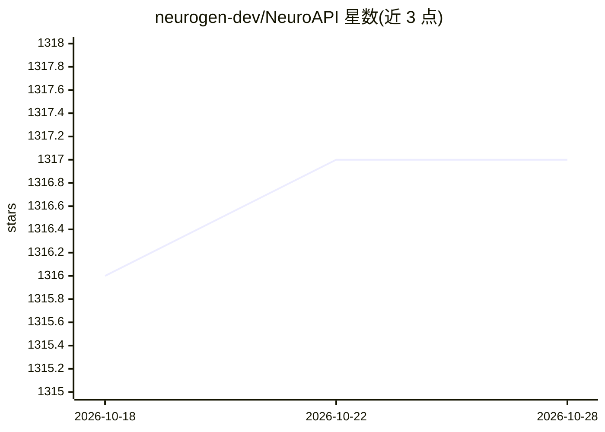

# neurogen-dev/NeuroAPI

⭐ 1,317 · PowerShell · MIT · 推送 2026-10-03 · [GitHub](https://github.com/neurogen-dev/NeuroAPI) · [官网](https://neuroapi.host) · 组织维护

**将 Codex CLI 与 Claude Code 一键接入 NeuroAPI（俄 AI API）的安装器**

面向使用 Codex CLI/Claude Code 终端客户端的用户，提供 Windows 与 macOS 一键安装脚本，把客户端接入 NeuroAPI API 服务（统一访问 OpenAI/Anthropic/Gemini/DeepSeek 模型，卢布计费，基础设施位于俄罗斯）。机制：创建独立配置文件，API 密钥经 DPAPI/Keychain 加密存储且不落入配置文件，生成 codex-neuroapi/claude-neuroapi 启动命令；可另行接入 Codex Desktop 与 Claude Desktop。安装器校验密钥可用性，CI 含语法检查与冒烟测试。

## 筛选速览

| 维度 | 判定 | 备注 |
|---|---|---|
| AI 角色 | `ai-ecosystem` | LLM/agent 周边工具 |
| 许可风险 | `permissive` | MIT |
| 部署形态 | `None` |  |
| 模型依赖 | — | README 未给出锁定关系 |
| 硬件要求 | — | 无带数字的原话,不猜 |
| 安装摩擦 | `low` | 无编译、无系统依赖或容器化 |
| 成熟度 | — | 结构信号不足 |

## 能力要点

- Windows BAT / macOS bash 一键安装，无需管理员权限与 sudo
- API 密钥经 Windows DPAPI / macOS Keychain 加密，不写入 .env/TOML/JSON
- 仅修改安装器自有文件，冲突时中止并备份原配置
- 提供 --doctor 诊断与 --doctor-generate 付费端到端验证模式

## 适用场景

- 在俄罗斯支付环境下让 Codex CLI / Claude Code 使用多供应商模型
- 安全地接入第三方 API 服务而不在配置文件中明文存密钥
- 安装后诊断连接与密钥可用性

## 场景标签

 · 领域:开发工具/AI API 接入

## 证据(README 行号)

> L7: Открытые установщики для подключения Codex CLI и Claude Code к NeuroAPI на Windows и macOS.
> L9: Пакет настраивает **клиенты в терминале** через команды `codex-neuroapi` и `claude-neuroapi`. При отдельном согласии
> L11: NeuroAPI — российский AI API-сервис: единый доступ к моделям OpenAI, Anthropic Claude, Google Gemini, DeepSeek, ген

## 星数曲线

2026-10-18 1,316 → 2026-10-28 1,317（+1）

---
*卡片 v1 · prompt 1.4 · 生成 2026-10-21 · 置信度 high · 依据 README sha `3c6608dc0159` · [字段定义](../../DATASET.md)*
