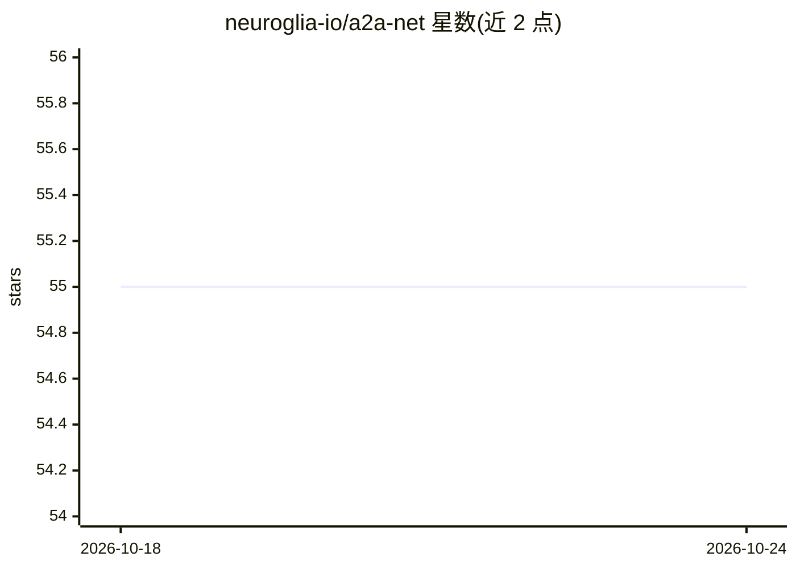

# neuroglia-io/a2a-net

⭐ 55 · C# · Apache-2.0 · 推送 2026-03-06 · [GitHub](https://github.com/neuroglia-io/a2a-net) · 组织维护

**A2A 协议的 .NET 实现：让异构 agent 间互操作通信**

以 C#/.NET 实现 Agent-to-Agent (A2A) 协议，提供客户端、服务端与传输层的完整组件：HTTP/gRPC/JSON-RPC 三种传输，agent 发现（agent card 解析）、任务全生命周期管理与状态持久化（内存或 Redis）、任务调度（内存或 Quartz）、事件流与推送通知。核心包零依赖。面向需要构建或接入 A2A 兼容 agent 的 .NET 开发者，通过 NuGet 包安装，并提供 Semantic Kernel 示例。

## 筛选速览

| 维度 | 判定 | 备注 |
|---|---|---|
| AI 角色 | `ai-ecosystem` | LLM/agent 周边工具 |
| 许可风险 | `permissive` | Apache-2.0 |
| 部署形态 | `None` |  |
| 模型依赖 | — | README 未给出锁定关系 |
| 硬件要求 | — | 无带数字的原话,不猜 |
| 安装摩擦 | `medium` | 含编译或系统依赖之一 |
| 成熟度 | — | 结构信号不足 |

## 能力要点

- A2A 协议的完整 .NET 实现，含 agent card、任务、artifact 等模型
- HTTP / gRPC / JSON-RPC 三种传输可选
- 任务状态持久化（内存/Redis）与调度（内存/Quartz）可插拔
- 提供 agent 发现、事件流与推送通知

## 适用场景

- 在 .NET 应用中构建 A2A 兼容的 agent 服务端
- 编写客户端发现并调用异构框架的 agent
- 跨框架/厂商的 agent 间结构化任务编排

## 场景标签

`Agent 框架` · 领域:Agent 开发

## 证据(README 行号)

> L3: **Agent-to-Agent (A2A)** is a lightweight, extensible protocol and framework for orchestrating tasks and exchanging 
> L150: - **🔄 Protocol Compliance**: Full implementation of the A2A protocol

## 星数曲线

2026-10-18 55 → 2026-10-24 55（+0）

---
*卡片 v1 · prompt 1.4 · 生成 2026-10-24 · 置信度 high · 依据 README sha `945495122414` · [字段定义](../../DATASET.md)*
