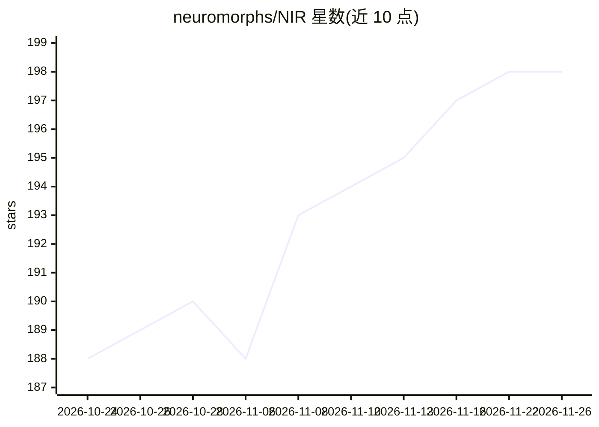

# neuromorphs/NIR

⭐ 198 · Jupyter Notebook · BSD-3-Clause · 推送 2026-11-23 · [GitHub](https://github.com/neuromorphs/NIR) · [官网](https://neuroir.org/docs) · 组织维护

**神经形态计算的中间表示：跨框架与硬件平台迁移模型**

NIR 提供一组跨神经形态框架与技术栈共享的计算原语，作为平台之间的模型交换格式。用户在源平台用 nir.write 保存模型图，在目标平台用 nir.read 加载，从而在模拟器与神经形态硬件之间移动模型。README 称当前有 9 个模拟器与 5 个硬件平台支持，附带框架读写支持矩阵与示例。安装上随用户所用框架一并安装，另有 NIRData 用于脉冲神经网络的数据交换。

## 筛选速览

| 维度 | 判定 | 备注 |
|---|---|---|
| AI 角色 | `ai-ecosystem` | LLM/agent 周边工具 |
| 许可风险 | `permissive` | BSD-3-Clause |
| 部署形态 | `library` | 以包/库形式分发 |
| 模型依赖 | — | README 未给出锁定关系 |
| 硬件要求 | — | 无带数字的原话,不猜 |
| 安装摩擦 | `low` | 无编译、无系统依赖或容器化 |
| 成熟度 | — | 结构信号不足 |

## 能力要点

- 9 个模拟器与 5 个硬件平台支持（README 自述）
- nir.write / nir.read 的模型保存与加载接口
- 提供各框架读写支持矩阵与配套示例
- NIRData 扩展用于 SNN 数据交换

## 适用场景

- 把模型从模拟器迁移到神经形态硬件平台
- 在不同神经形态框架之间交换模型
- 为团队统一模型描述格式以降低平台耦合

## 场景标签

 · 领域:神经形态计算/模型互操作

## 证据(README 行号)

> L11: NIR is a set of computational primitives, shared across different neuromorphic frameworks and technology stacks.
> L14: NIR is useful when you want to move a model from one platform to another, for instance from a simulator to a hardwa
> L23: NIR serves as a format between neuromorphic platforms and will be installed alongside your framework of choice.

## 星数曲线

2026-10-24 188 → 2026-11-26 198（+10）

---
*卡片 v1 · prompt 1.4 · 生成 2026-11-25 · 置信度 high · 依据 README sha `cdfac211987d` · [字段定义](../../DATASET.md)*
