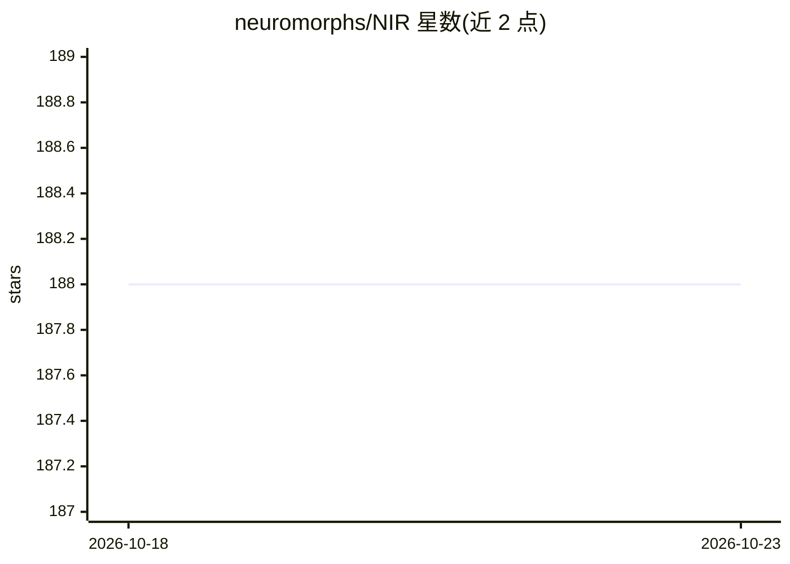

# neuromorphs/NIR

⭐ 188 · Jupyter Notebook · BSD-3-Clause · 推送 2026-09-28 · [GitHub](https://github.com/neuromorphs/NIR) · [官网](https://neuroir.org/docs) · 组织维护

**神经形态模型跨平台交换的中间表示格式**

NIR 定义一组跨神经形态框架与技术栈共享的计算原语，作为脉冲神经网络模型在模拟器与硬件平台之间迁移的统一中间格式：源平台用 nir.write 导出 .nir 图，目标平台用 nir.read 导入。README 声明被 9 个模拟器与 5 个硬件平台支持（Norse、snnTorch、Lava-DL、Sinabs/Speck、SpiNNaker2 等），并扩展了用于数据交换的 NIRData。随各框架安装使用，附论文引用。

## 筛选速览

| 维度 | 判定 | 备注 |
|---|---|---|
| AI 角色 | `ai-ecosystem` | LLM/agent 周边工具 |
| 许可风险 | `permissive` | BSD-3-Clause |
| 部署形态 | `library` | 以包/库形式分发 |
| 模型依赖 | — | README 未给出锁定关系 |
| 硬件要求 | — | 无带数字的原话,不猜 |
| 安装摩擦 | `low` | 无编译、无系统依赖或容器化 |
| 成熟度 | — | 结构信号不足 |

## 能力要点

- 定义跨神经形态框架共享的计算原语集合
- 读写 .nir 文件实现模型在平台间迁移
- README 列出 9 个模拟器与 5 个硬件平台的支持矩阵
- 扩展 NIRData 作为脉冲神经网络数据交换表示

## 适用场景

- 把 SNN 模型从模拟器迁移到神经形态硬件
- 在不同神经形态框架之间交换模型
- 跨平台复用脉冲神经网络训练成果

## 场景标签

 · 领域:神经形态计算/机器学习基础设施

## 证据(README 行号)

> L11: NIR is a set of computational primitives, shared across different neuromorphic frameworks and technology stacks.
> L14: NIR is useful when you want to move a model from one platform to another, for instance from a simulator to a hardwa
> L23: NIR serves as a format between neuromorphic platforms and will be installed alongside your framework of choice.

## 星数曲线

2026-10-18 188 → 2026-10-23 188（+0）

---
*卡片 v1 · prompt 1.4 · 生成 2026-10-22 · 置信度 high · 依据 README sha `aaf38d906c79` · [字段定义](../../DATASET.md)*
