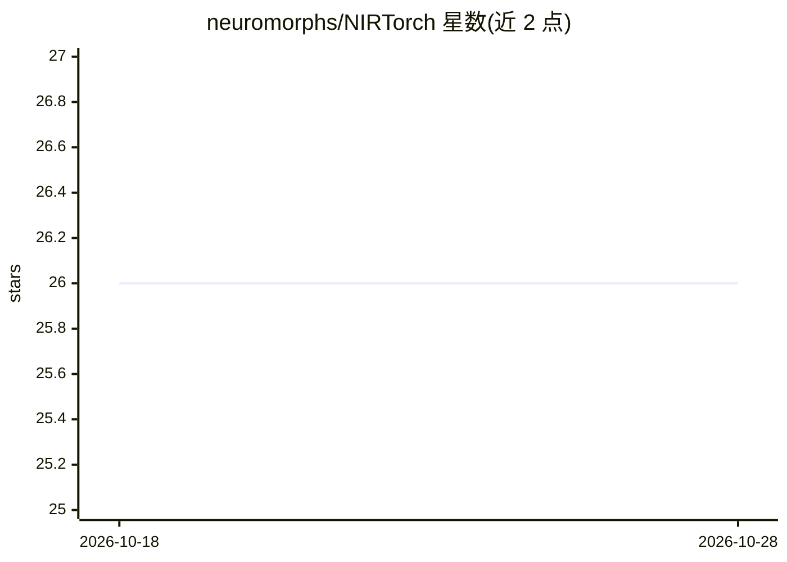

# neuromorphs/NIRTorch

⭐ 26 · Python · BSD-3-Clause · 推送 2026-09-18 · [GitHub](https://github.com/neuromorphs/NIRTorch) · [官网](https://neuroir.org/docs) · 组织维护

**PyTorch 与神经形态中间表示 NIR 互转的辅助库**

面向库与硬件开发者的 Python 包，提供 nir_to_torch 与 torch_to_nir 两个函数，在 NIR 计算图与 PyTorch 模块之间双向转换。开发者通过提供节点字典（NIR 节点到 torch.nn.Module 的映射，或反向映射）定义转换规则，NIRTorch 自动追踪 PyTorch 图并构建 NIR 图。示例取自 Norse 库，配套文档在 neuroir.org/docs，相关成果发表于 Nature Communications。

## 筛选速览

| 维度 | 判定 | 备注 |
|---|---|---|
| AI 角色 | `ai-ecosystem` | LLM/agent 周边工具 |
| 许可风险 | `permissive` | BSD-3-Clause |
| 部署形态 | `library` | 以包/库形式分发 |
| 模型依赖 | — | README 未给出锁定关系 |
| 硬件要求 | — | 无带数字的原话,不猜 |
| 安装摩擦 | `low` | 无编译、无系统依赖或容器化 |
| 成熟度 | — | 结构信号不足 |

## 能力要点

- 提供 nir_to_torch / torch_to_nir 双向转换函数
- 开发者以节点映射字典自定义转换规则
- 自动追踪 PyTorch 图逐模块构建 NIR 图
- 配套 Nature Communications 论文与 neuroir.org 文档

## 适用场景

- 让基于 PyTorch 的 SNN 库导出为 NIR 中间表示
- 将 NIR 图导入并生成 Torch 模块
- 神经形态硬件/库开发者接入 NIR 互操作生态

## 场景标签

 · 领域:神经形态计算/机器学习工具

## 证据(README 行号)

> L11: PyTorch helpers for the Neuromorphic Intermediate Representation (NIR).
> L25: NIRTorch provides two functions `nir_to_torch` and `torch_to_nir` that maps NIR graphs to Torch and vice versa.

## 星数曲线

2026-10-18 26 → 2026-10-28 26（+0）

---
*卡片 v1 · prompt 1.4 · 生成 2026-10-26 · 置信度 high · 依据 README sha `bfc67c0efc54` · [字段定义](../../DATASET.md)*
