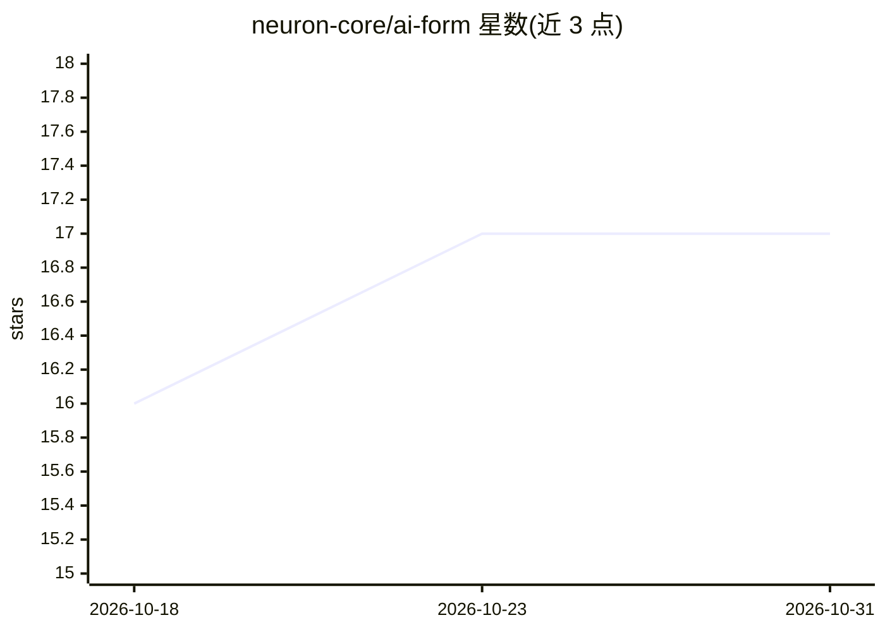

# neuron-core/ai-form

⭐ 17 · PHP · MIT · 推送 2026-04-01 · [GitHub](https://github.com/neuron-core/ai-form) · [官网](https://docs.neuron-ai.dev) · 组织维护

**PHP 对话式结构化数据收集组件：通过多轮对话渐进收集并校验字段**

基于 Neuron AI Workflow 的 PHP 组件，用于在多轮自然语言对话中收集结构化数据：以 PHP attribute 定义数据类与验证规则（NotBlank/Email 等），AI agent 逐字段收集并校验，维护会话历史、已收集字段、缺失字段与校验错误。支持确认模式（收集完成后抛出 FormInterruptRequest 暂停工作流，用户确认后可恢复）、固定确认/拒绝/退出短语识别及自定义 detectExit。原生支持 Inspector 监控，需设置 INSPECTOR_INGESTION_KEY。面向使用 Neuron AI 框架的 PHP 开发者。

## 筛选速览

| 维度 | 判定 | 备注 |
|---|---|---|
| AI 角色 | `ai-ecosystem` | LLM/agent 周边工具 |
| 许可风险 | `permissive` | MIT |
| 部署形态 | `None` |  |
| 模型依赖 | — | README 未给出锁定关系 |
| 硬件要求 | — | 无带数字的原话,不猜 |
| 安装摩擦 | `low` | 无编译、无系统依赖或容器化 |
| 成熟度 | — | 结构信号不足 |

## 能力要点

- 以 PHP attribute 定义数据类与验证规则，对话中渐进收集结构化数据
- 确认模式下抛出 FormInterruptRequest 暂停工作流，确认后可恢复提交
- 内置确认/拒绝/取消短语识别，可覆写 detectExit 自定义退出逻辑
- 基于 Neuron AI Workflow，原生支持 Inspector 监控与调试

## 适用场景

- 在 PHP 应用中用对话方式替代传统表单收集用户信息
- 需要用户在提交前确认所填数据的注册/登记类流程
- 对收集过程进行监控与调试

## 场景标签

`Agent 框架` · 领域:Agent 开发

## 证据(README 行号)

> L3: AIForm is a component for collecting structured data through multi-turn natural language conversations. It uses an A
> L149: This package is built on top of the Neuron AI Workflow component, just like the Agent class, but

## 星数曲线

2026-10-18 16 → 2026-10-31 17（+1）

---
*卡片 v1 · prompt 1.4 · 生成 2026-10-29 · 置信度 high · 依据 README sha `f83987e34c34` · [字段定义](../../DATASET.md)*
