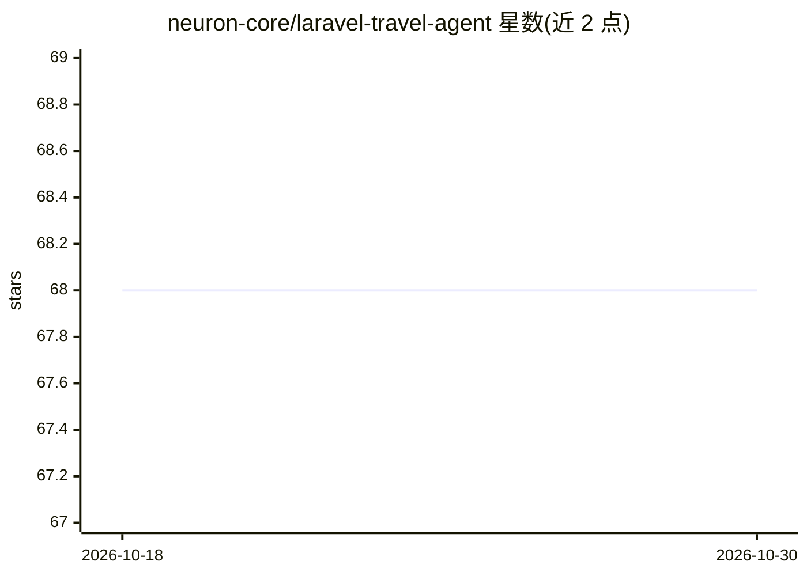

# neuron-core/laravel-travel-agent

⭐ 68 · Blade · 推送 2026-01-12 · [GitHub](https://github.com/neuron-core/laravel-travel-agent) · [官网](https://docs.neuron-ai.inspector.dev) · 组织维护

**Laravel 旅行规划多 Agent 示例应用（基于 Neuron PHP 框架）**

基于 Laravel + Livewire 构建的旅行规划演示应用：使用 Neuron PHP AI 框架的 Workflow 编排多 Agent（Receptionist 收集需求、Delegator 分别生成航班/酒店/景点报告、GenerateItinerary 汇总行程），通过 SerpAPI 检索真实数据，至少需要一个 LLM 提供商 API key（Anthropic/Gemini 等）运行。面向想在 PHP/Laravel 中实践 AI Agent 开发的开发者，可选接入 Inspector 监控 Agent 执行时间线。

## 筛选速览

| 维度 | 判定 | 备注 |
|---|---|---|
| AI 角色 | `ai-native` | 本体是模型或模型工具 |
| 许可风险 | `none` | — |
| 部署形态 | `library` | 以包/库形式分发 |
| 模型依赖 | — | README 未给出锁定关系 |
| 硬件要求 | — | 无带数字的原话,不猜 |
| 安装摩擦 | `low` | 无编译、无系统依赖或容器化 |
| 成熟度 | — | 结构信号不足 |

## 能力要点

- Neuron Workflow 多 Agent 编排：接待、分派、行程生成三类节点
- SerpAPI 检索航班、酒店、景点并生成研究报告
- 可切换 LLM、向量库、Embedding 提供商（Neuron 框架能力）
- 集成 Inspector 监控 Agent 执行时间线

## 适用场景

- 学习在 Laravel 应用中集成多 Agent 工作流
- 参考 Neuron 框架的 Agent 节点拆分与编排方式
- 搭建可对话生成旅行行程的演示应用

## 场景标签

`多智能体` · 领域:Agent 开发

## 证据(README 行号)

> L42: This project demonstrates how to integrate multi-agent workflows in a Laravel application
> L48: - Neuron Workflow for multi-agent orchestration.
> L54: Neuron is an agentic framework that allows you to create full-featured AI Agents in PHP.

## 星数曲线

2026-10-18 68 → 2026-10-30 68（+0）

---
*卡片 v1 · prompt 1.4 · 生成 2026-10-24 · 置信度 high · 依据 README sha `ae4d0be52d29` · [字段定义](../../DATASET.md)*
