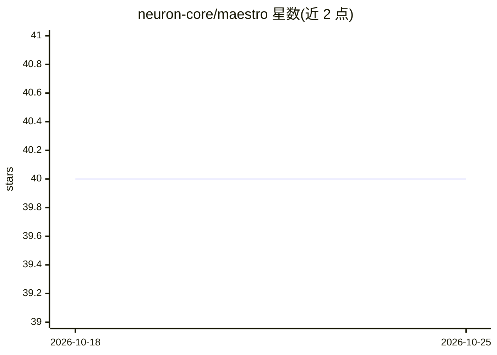

# neuron-core/maestro

⭐ 40 · PHP · NOASSERTION · 推送 2026-06-19 · [GitHub](https://github.com/neuron-core/maestro) · 组织维护

**PHP 编写的 CLI 编码 agent，交互式对话与工具审批**

基于 Neuron AI 框架、以 PHP 实现的命令行编码 agent：提供交互式聊天会话、工具调用前的人工审批（Allow once/session/Deny）、diff 与 markdown 终端渲染。支持 Anthropic、OpenAI、Gemini、Cohere、Mistral、Ollama、Grok、Deepseek 等多种提供商，可接入 MCP 服务器扩展能力，并通过 PHP 扩展系统自定义工具、命令、渲染器、事件与记忆。Windows 需在 WSL 环境运行，通过 Composer 全局安装；会话可集成 Inspector 监控。采用 FSL 许可证。

## 筛选速览

| 维度 | 判定 | 备注 |
|---|---|---|
| AI 角色 | `ai-native` | 本体是模型或模型工具 |
| 许可风险 | `none` | NOASSERTION |
| 部署形态 | `None` |  |
| 模型依赖 | local-ok | 支持本地模型 |
| 硬件要求 | — | 无带数字的原话,不猜 |
| 安装摩擦 | `low` | 无编译、无系统依赖或容器化 |
| 成熟度 | — | 结构信号不足 |

## 能力要点

- PHP 实现的 CLI agent，含工具审批（human-in-the-loop）机制
- 多提供商支持：Anthropic/OpenAI/Gemini/Cohere/Mistral/Ollama/Grok/Deepseek
- MCP 服务器集成与 PHP 扩展系统（工具/命令/渲染器/事件/记忆）
- Inspector 会话监控集成

## 适用场景

- 在终端项目中通过对话让 agent 执行编码操作
- 需要审批敏感操作后再执行的 AI 编码工作流
- 为 agent 添加自定义工具、命令或记忆的 PHP 开发者

## 场景标签

`编码 Agent` · 领域:编码与开发

## 证据(README 行号)

> L3: **Maestro** is the first CLI agent built entirely in PHP with the Neuron AI framework.
> L21: - **Multi-Provider AI Support**: Choose from Anthropic Claude, OpenAI, Gemini, Cohere, Mistral, Ollama, Grok, or De
> L131: Start an interactive chat session:

## 星数曲线

2026-10-18 40 → 2026-10-25 40（+0）

---
*卡片 v1 · prompt 1.4 · 生成 2026-10-25 · 置信度 high · 依据 README sha `853106990328` · [字段定义](../../DATASET.md)*
