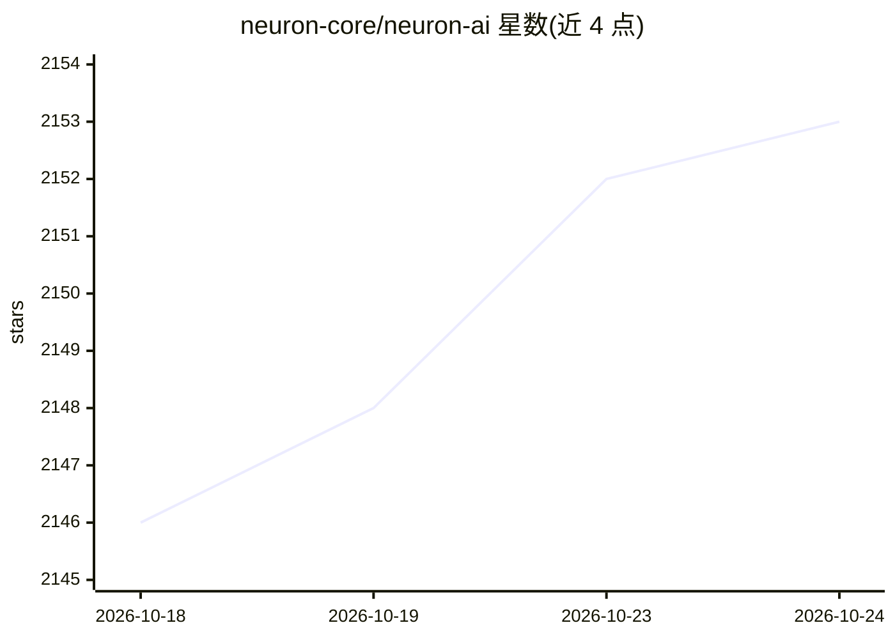

# neuron-core/neuron-ai

⭐ 2,153 · PHP · MIT · 推送 2026-10-21 · [GitHub](https://github.com/neuron-core/neuron-ai) · [官网](https://neuron-ai.dev) · 组织维护

**PHP 生态的 AI Agent 开发框架：编排 LLM、工具与 RAG**

Neuron AI 是用于创建和编排 AI Agent 的 PHP 框架，提供 Agent 基类、工具/工具箱、MCP 连接器、结构化输出、RAG、多组件编排的 Workflow（含 human-in-the-loop）与流式输出等能力。支持约 17 种 LLM 提供商切换，同一 Agent 实现无需改动。要求 PHP ^8.1，通过 composer 安装，提供 CLI 脚手架命令生成 Agent 与 RAG，并配套文档、教程与 Inspector 监控渠道。

## 筛选速览

| 维度 | 判定 | 备注 |
|---|---|---|
| AI 角色 | `ai-ecosystem` | LLM/agent 周边工具 |
| 许可风险 | `permissive` | MIT |
| 部署形态 | `self-host` | docker 或自建部署 |
| 模型依赖 | local-ok | 支持本地模型 |
| 硬件要求 | — | 无带数字的原话,不猜 |
| 安装摩擦 | `low` | 无编译、无系统依赖或容器化 |
| 成熟度 | — | 结构信号不足 |

## 能力要点

- Agent 基类自动管理记忆、工具与 RAG 机制
- 一行代码切换约 17 种 LLM 提供商（Anthropic/OpenAI/Ollama/Gemini/AWS Bedrock 等）
- Workflow 支持从零编排多 Agent 系统与 human-in-the-loop 人工干预
- 提供 MCP 连接器、结构化输出与 CLI 脚手架（make:agent / make:rag）

## 适用场景

- 在 PHP 应用中构建带工具调用与记忆的 AI Agent
- 搭建基于向量库与嵌入的 RAG 问答
- 编排含人工审批环节的多 Agent 工作流

## 场景标签

`Agent 框架` `多智能体` `RAG` · 领域:Agent 开发

## 证据(README 行号)

> L14: Neuron is a PHP framework for creating and orchestrating AI Agents. It allows you to integrate AI entities into you
> L16: from LLM interfaces, data loading, multi-agent orchestration, to monitoring and debugging.

## 星数曲线

2026-10-18 2,146 → 2026-10-24 2,153（+7）

---
*卡片 v1 · prompt 1.4 · 生成 2026-10-21 · 置信度 mid · 依据 README sha `81432d1398d2` · [字段定义](../../DATASET.md)*
