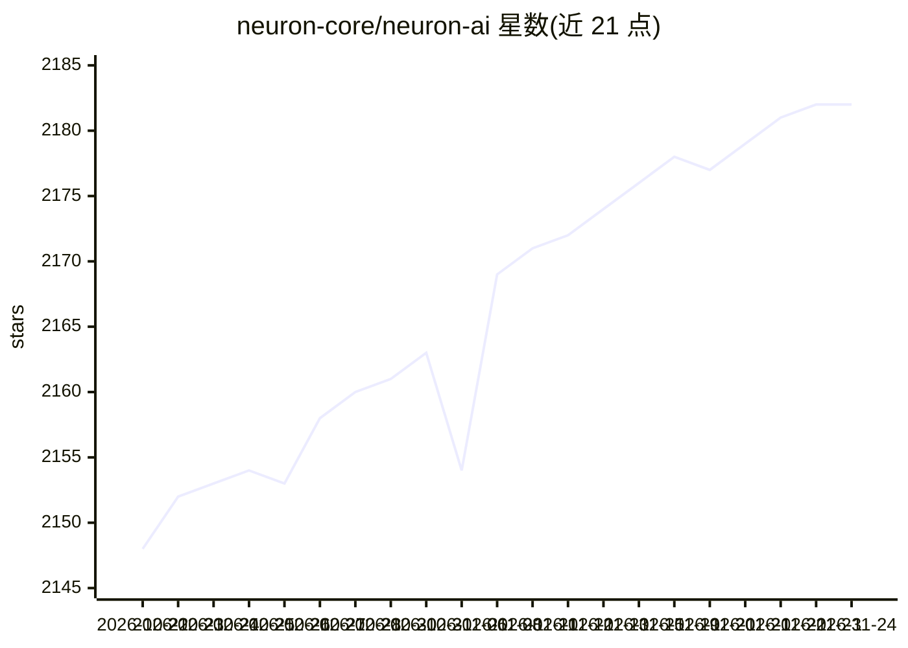

# neuron-core/neuron-ai

⭐ 2,182 · PHP · MIT · 推送 2026-11-20 · [GitHub](https://github.com/neuron-core/neuron-ai) · [官网](https://neuron-ai.dev) · 组织维护

**PHP 生态构建生产级 AI Agent 的框架**

Neuron AI 是面向 PHP 开发者的 Agent 框架，覆盖从 LLM 接口、数据加载、多 Agent 编排到监控调试的完整开发生命周期。核心机制包括可扩展的 Agent 类（内置记忆、工具、RAG）、带检查点与人在环的 Workflow、MCP 连接器、结构化输出、流式与 UI 协议集成（AG-UI、Vercel AI SDK）。要求 PHP ^8.1，通过 composer 安装，另提供 Skills 与 MCP server 供 AI 编码助手获取上下文。配套教程、电子书与 Inspector 监控服务。

## 筛选速览

| 维度 | 判定 | 备注 |
|---|---|---|
| AI 角色 | `ai-ecosystem` | LLM/agent 周边工具 |
| 许可风险 | `permissive` | MIT |
| 部署形态 | `self-host` | docker 或自建部署 |
| 模型依赖 | local-ok | 支持本地模型 |
| 硬件要求 | — | 无带数字的原话,不猜 |
| 安装摩擦 | `low` | 无编译、无系统依赖或容器化 |
| 成熟度 | — | 结构信号不足 |

## 能力要点

- 一行代码切换 17 种 LLM provider（含 Ollama、Bedrock、DashScope）
- Workflow 支持检查点、人在环、中断与多 Agent 编排
- MCP 连接器直接接入外部 MCP server 工具
- 提供 AI 辅助开发资源（Skills、MCP server）

## 适用场景

- 在 PHP 应用中集成带记忆与工具调用的 Agent
- 构建需要人工审批环节的多 Agent 工作流
- 用向量库与嵌入搭建 RAG 聊天机器人
- 让 Agent 自然语言查询数据库并输出结构化结果

## 场景标签

`Agent 框架` `多智能体` `RAG` · 领域:Agent 开发

## 证据(README 行号)

> L14: Neuron is a PHP framework for creating and orchestrating AI Agents. It allows you to integrate AI entities into you
> L16: from LLM interfaces, data loading, multi-agent orchestration, to monitoring and debugging.

## 星数曲线

2026-10-22 2,148 → 2026-11-24 2,182（+34）

---
*卡片 v1 · prompt 1.4 · 生成 2026-11-23 · 置信度 mid · 依据 README sha `34d9a791f298` · [字段定义](../../DATASET.md)*
