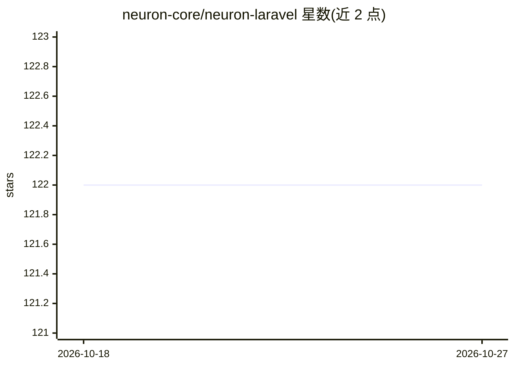

# neuron-core/neuron-laravel

⭐ 122 · PHP · MIT · 推送 2026-09-30 · [GitHub](https://github.com/neuron-core/neuron-laravel) · [官网](https://docs.neuron-ai.dev/) · 组织维护

**Neuron AI 框架的 Laravel 集成 SDK，简化 PHP AI agent 开发**

为 Laravel 开发者封装 Neuron AI PHP agent 框架的集成包：提供 AI provider/embedding 凭据配置文件、生成常用组件的 artisan 命令、自动实例化 provider 与向量存储的 Facade、EloquentChatHistory 迁移与 ChatMessage 模型。Neuron Facade 暴露 chat/stream/structured 三种交互模式，可附加工具与中间件（如 ToolApproval）。支持 Anthropic、OpenAI、Gemini、Ollama、DeepSeek 等多种 provider，可配置 embedding 与向量存储实现 RAG，并接入 Inspector 做监控。要求 PHP>=8.2、Laravel>=10.x，通过 composer 安装。

## 筛选速览

| 维度 | 判定 | 备注 |
|---|---|---|
| AI 角色 | `ai-ecosystem` | LLM/agent 周边工具 |
| 许可风险 | `permissive` | MIT |
| 部署形态 | `None` |  |
| 模型依赖 | local-ok | 支持本地模型 |
| 硬件要求 | — | 无带数字的原话,不猜 |
| 安装摩擦 | `low` | 无编译、无系统依赖或容器化 |
| 成熟度 | — | 结构信号不足 |

## 能力要点

- Neuron Facade 提供 chat/stream/structured 三种交互模式，可链式附加工具与节点中间件
- artisan 命令生成 agent、工具等常用组件以减少样板代码
- 内置 EloquentChatHistory 迁移与 ChatMessage 模型管理会话记忆
- 支持 Anthropic/OpenAI/Gemini/Ollama/DeepSeek 等多种 AI provider 与 RAG 配置

## 适用场景

- 在 Laravel 应用中快速搭建 AI agent 与对话功能
- 基于 Eloquent 实现 agent 的聊天历史与记忆
- 配置 embedding 与向量存储构建 RAG 应用
- 通过 Inspector 监控与调试多步骤 agent 执行

## 场景标签

`Agent 框架` `RAG` · 领域:Agent 开发

## 证据(README 行号)

> L9: This package aims to make it easier for Laravel developers to get started with AI agent development using Neuron AI 
> L23: Neuron is the leading PHP framework for creating and orchestrating AI Agents. It allows you to integrate AI entitie
> L25: from LLM interfaces, data loading, to multi-agent orchestration, monitoring and debugging.

## 星数曲线

2026-10-18 122 → 2026-10-27 122（+0）

---
*卡片 v1 · prompt 1.4 · 生成 2026-10-23 · 置信度 high · 依据 README sha `75aa5c4195cc` · [字段定义](../../DATASET.md)*
