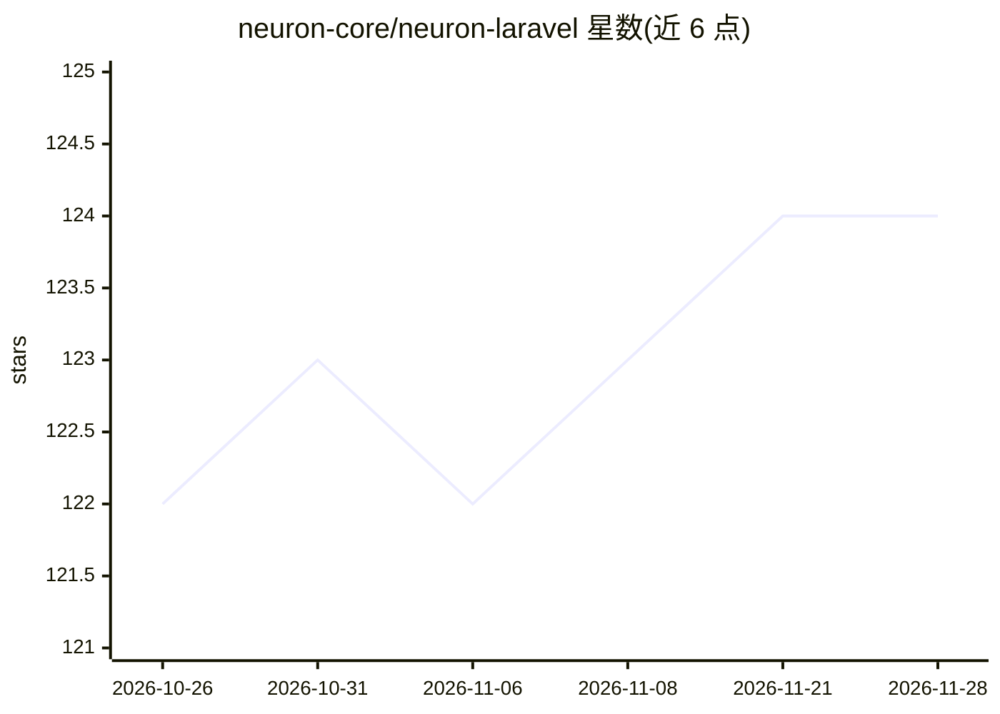

# neuron-core/neuron-laravel

⭐ 124 · PHP · MIT · 推送 2026-11-17 · [GitHub](https://github.com/neuron-core/neuron-laravel) · [官网](https://docs.neuron-ai.dev/) · 组织维护

**Neuron AI 的 Laravel SDK，现计划归档**

官方说明 Neuron AI 与 Laravel 的集成 SDK。当前 README 仅含归档声明：该包计划归档，Neuron AI 集成的最佳实践已迁移至 neuron-ai 仓库 4.x 分支下的框架技能文件，分别覆盖 Laravel 与 Symfony 集成。README 未提供安装方式、用法示例或功能说明，功能细节需参考迁移目标仓库。

## 筛选速览

| 维度 | 判定 | 备注 |
|---|---|---|
| AI 角色 | `ai-ecosystem` | LLM/agent 周边工具 |
| 许可风险 | `permissive` | MIT |
| 部署形态 | `None` |  |
| 模型依赖 | — | README 未给出锁定关系 |
| 硬件要求 | — | 无带数字的原话,不猜 |
| 安装摩擦 | `low` | 无编译、无系统依赖或容器化 |
| 成熟度 | — | 结构信号不足 |

## 能力要点

- Neuron AI 官方 Laravel SDK
- 计划归档，文档迁移至 neuron-ai 仓库的框架技能
- 提供 Laravel 与 Symfony 两条集成指引链接

## 适用场景

- 在 Laravel 项目中集成 Neuron AI（需转向迁移后的技能文档）
- 查找 Neuron AI 与 Symfony 的集成方式

## 场景标签

 · 领域:LLM 基础设施/应用框架集成

## 证据(README 行号)

> L2: > This package is planned to be archived. Neuron AI integration best practices are now in the framework skills:
> L3: > - https://github.com/neuron-core/neuron-ai/tree/4.x/skills/neuron-laravel-integration

## 星数曲线

2026-10-26 122 → 2026-11-28 124（+2）

---
*卡片 v1 · prompt 1.4 · 生成 2026-11-28 · 置信度 mid · 依据 README sha `dd11af429cdf` · [字段定义](../../DATASET.md)*
