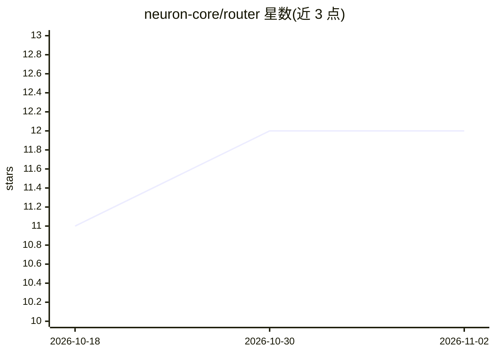

# neuron-core/router

⭐ 12 · PHP · MIT · 推送 2026-10-08 · [GitHub](https://github.com/neuron-core/router) · [官网](https://docs.neuron-ai.dev) · 组织维护

**PHP 的 LLM 推理调用路由层：按规则与故障转移分发到多个提供商**

Neuron AI 生态的 Composer 包，提供 RouterProvider 组件：实现 AIProviderInterface，将 chat/stream/structured 推理调用按自定义路由规则分发到不同底层提供商（Anthropic/OpenAI/Gemini 等），并可定义故障转移顺序，在限流、429、5xx 等瞬态错误时自动切换下一提供商。内置 MethodRule、LoadBalancingRule、按难度分类的 DifficultyRule、按多模态内容分流的 ContentRule 等规则，支持自定义规则、带退避的重试与流式请求的首连降级。以 composer 包安装，面向构建 PHP AI agent 的开发者。

## 筛选速览

| 维度 | 判定 | 备注 |
|---|---|---|
| AI 角色 | `ai-ecosystem` | LLM/agent 周边工具 |
| 许可风险 | `permissive` | MIT |
| 部署形态 | `None` |  |
| 模型依赖 | — | README 未给出锁定关系 |
| 硬件要求 | — | 无带数字的原话,不猜 |
| 安装摩擦 | `low` | 无编译、无系统依赖或容器化 |
| 成熟度 | — | 结构信号不足 |

## 能力要点

- 按推理方法/负载均衡/难度分类/多模态内容分发的内置路由规则，支持自定义 RoutingRuleInterface
- 瞬态错误（超时/429/5xx）自动按故障转移顺序切换提供商
- 带固定或指数退避的同提供商重试
- 对 agent 透明，可直接替换任何 Neuron AI 提供商

## 适用场景

- 提供商限流或故障时自动切换备用模型保障可用性
- 图像或视频请求路由到支持多模态的提供商
- 按任务难度将请求分给不同能力层级的模型
- 将 structured 调用路由到结构化输出支持更好的提供商

## 场景标签

`模型网关` · 领域:Agent 开发

## 证据(README 行号)

> L9: This package provides you with a `RouterProvider` component. It is a proxy that implements `AIProviderInterface` and
> L12: At its simplest, the router is a reliability layer: define a **fallback order** of providers and if one fails with 

## 星数曲线

2026-10-18 11 → 2026-11-02 12（+1）

---
*卡片 v1 · prompt 1.4 · 生成 2026-11-01 · 置信度 high · 依据 README sha `ebc6d70b0059` · [字段定义](../../DATASET.md)*
