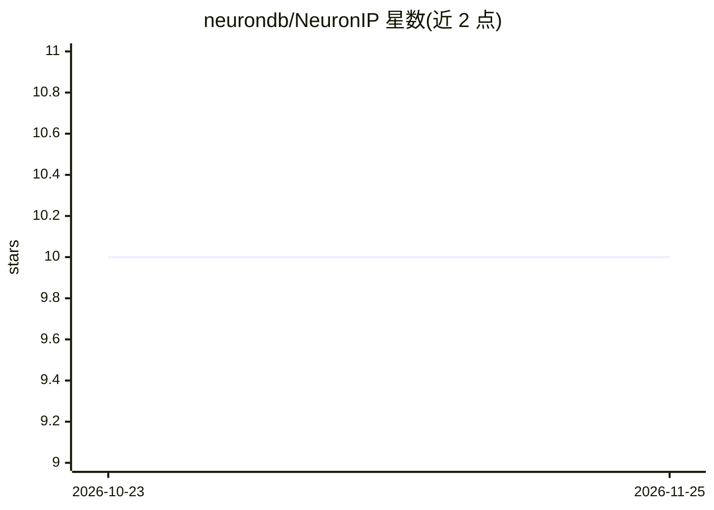

# neurondb/NeuronIP

⭐ 10 · Go · CC0-1.0 · 推送 2026-02-02 · [GitHub](https://github.com/neurondb/NeuronIP) · [官网](https://www.neurondb.ai) · 个人维护

**为 PostgreSQL 加 AI 智能层：语义搜索、问答、Agent 工作流**

基于 PostgreSQL（需 NeuronDB 扩展）的 AI 智能与自动化平台，统一提供五项能力：语义知识搜索、数据仓库自然语言问答（生成 SQL 与图表）、客服记忆（Agent 长期记忆与工单分类）、合规审计分析（策略匹配与异常检测）、Agent 工作流执行。技术栈为 Go 后端 + Next.js 前端，通过 REST API 提供服务，支持 Docker Compose 部署或源码编译；可与 NeuronDB 生态（NeuronAgent、NeuronMCP）集成，也可独立运行。

## 筛选速览

| 维度 | 判定 | 备注 |
|---|---|---|
| AI 角色 | `ai-native` | 本体是模型或模型工具 |
| 许可风险 | `viral` | CC0-1.0 |
| 部署形态 | `self-host` | docker 或自建部署 |
| 模型依赖 | — | README 未给出锁定关系 |
| 硬件要求 | — | 无带数字的原话,不猜 |
| 安装摩擦 | `low` | 无编译、无系统依赖或容器化 |
| 成熟度 | `idea` | |

## 能力要点

- 五合一平台：语义搜索/仓库问答/客服记忆/合规分析/Agent 工作流
- 自然语言转 SQL 并返回图表与解释
- REST API + API Key 认证，含 RBAC 与审计日志
- Docker Compose 一键部署，可独立于 NeuronAgent/NeuronMCP 运行

## 适用场景

- 对知识库做语义检索与问答
- 业务人员用自然语言查询数据仓库并生成报告
- 为客服系统提供自动工单处理与相似案例检索
- 对数据访问做合规检查与异常检测

## 场景标签

`语义搜索` `Agent 记忆` `工作流自动化` `数据分析` · 领域:Agent 开发

## 证据(README 行号)

> L12:  NeuronIP is the AI-native intelligence and automation layer for PostgreSQL. It turns your database into an enterpr
> L14:  Five core capabilities unified into one platform: Semantic Knowledge Search , Data Warehouse Q&A , Customer Suppor
> L66: **Ask questions in natural language and get SQL + charts + explanations:**

## 星数曲线

2026-10-23 10 → 2026-11-25 10（+0）

---
*卡片 v1 · prompt 1.4 · 生成 2026-11-19 · 置信度 high · 依据 README sha `559ef7db634c` · [字段定义](../../DATASET.md)*
