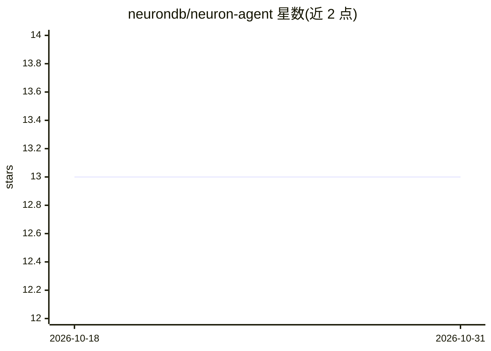

# neurondb/neuron-agent

⭐ 13 · Go · NOASSERTION · 推送 2026-05-02 · [GitHub](https://github.com/neurondb/neuron-agent) · [官网](https://www.neurondb.ai) · 组织维护

**构建于 PostgreSQL 的数据库原生 agent 运行时后端**

以 Go 编写的 agentic 服务器，运行在 PostgreSQL 与 NeuronDB 之上：提供持久记忆、RAG 摄取、SQL 原生工具（NeuronSQL 路由）、工作流 DAG 与审计 API，通过 REST/WebSocket 暴露，并以 /claw/v1 桥接兼容 OpenClaw 渠道网关。面向需要可靠状态管理与工具调用的 agent 应用开发者，定位是后端基础设施而非终端对话产品。通过 Docker Compose 或 make build 安装；向量/RAG 能力需配合 NeuronDB 扩展，纯 postgres:17-alpine 仅可跑冒烟测试。

## 筛选速览

| 维度 | 判定 | 备注 |
|---|---|---|
| AI 角色 | `ai-ecosystem` | LLM/agent 周边工具 |
| 许可风险 | `none` | NOASSERTION |
| 部署形态 | `self-host` | docker 或自建部署 |
| 模型依赖 | — | README 未给出锁定关系 |
| 硬件要求 | — | 无带数字的原话,不猜 |
| 安装摩擦 | `low` | 无编译、无系统依赖或容器化 |
| 成熟度 | — | 结构信号不足 |

## 能力要点

- REST/WebSocket API 覆盖 agents、sessions、memory、tools、workflows、RAG
- OpenClaw 兼容桥接（/claw/v1 health、tools/list、tools/run）
- 工作流 DAG 支持 cron 调度、重试与执行历史
- 多租户：API key、角色、metrics 与标准健康探针

## 适用场景

- 为客服/内部运营 agent 提供带审计踪迹的事务型后端
- 构建基于 PostgreSQL 的 SQL/数据 copilot
- 以 OpenClaw 等渠道网关接入，由本服务承载记忆与工具状态

## 场景标签

`Agent 框架` `Agent 记忆` `RAG` · 领域:Agent 开发

## 证据(README 行号)

> L3: **Database-native agent runtime** on PostgreSQL and NeuronDB: durable memory, RAG, SQL-native tooling, workflows, an
> L47: |**NeuronAgent**|Transactional agent brain: memory, tools, workflows, audit|

## 星数曲线

2026-10-18 13 → 2026-10-31 13（+0）

---
*卡片 v1 · prompt 1.4 · 生成 2026-10-31 · 置信度 high · 依据 README sha `c1e0e40e3928` · [字段定义](../../DATASET.md)*
