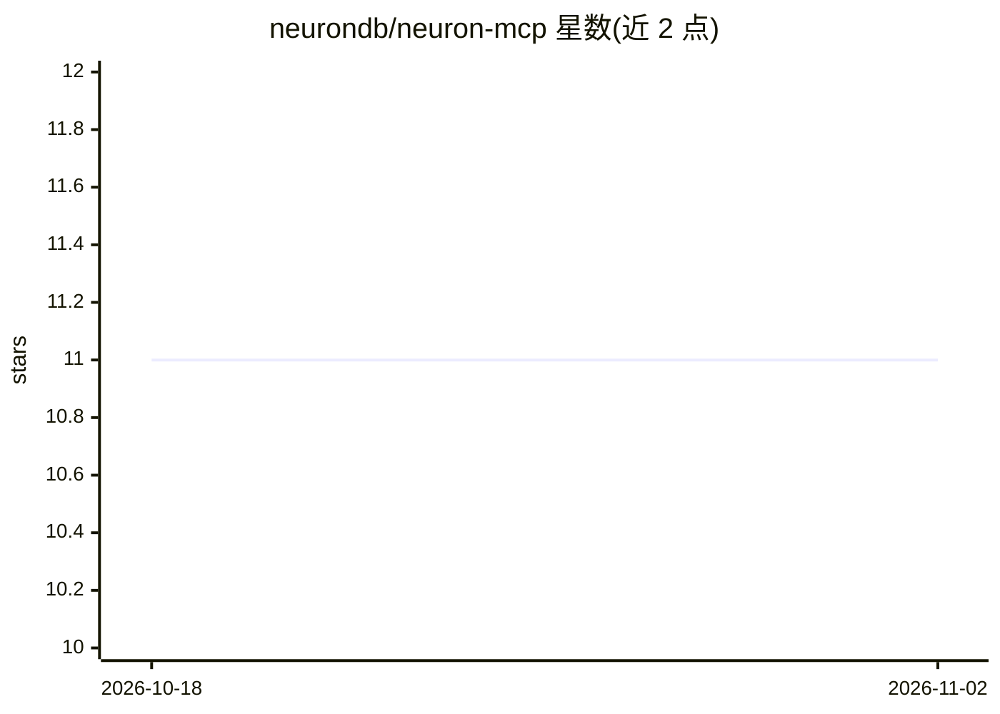

# neurondb/neuron-mcp

⭐ 11 · Go · NOASSERTION · 推送 2026-03-15 · [GitHub](https://github.com/neurondb/neuron-mcp) · [官网](https://www.neurondb.ai) · 组织维护

**让 MCP 客户端访问 NeuronDB 向量/ML/RAG 能力的 Go 语言 MCP 服务器**

用 Go 实现的 Model Context Protocol 服务器，通过 JSON-RPC 2.0（stdio/HTTP/SSE 传输）让 Claude Desktop 等 MCP 客户端访问 NeuronDB PostgreSQL 扩展：650+ 工具覆盖向量检索与索引（HNSW/IVF）、ML 训练/预测/AutoML/ONNX、RAG 文档处理与响应生成、以及 100+ PostgreSQL 管理工具；另提供资源订阅、Prometheus 指标、JWT/OAuth2 认证。面向需要把数据库 AI 能力接入 agent 客户端的开发者，需自备 PostgreSQL 16+ 与 NeuronDB 扩展，从源码编译运行。

## 筛选速览

| 维度 | 判定 | 备注 |
|---|---|---|
| AI 角色 | `ai-ecosystem` | LLM/agent 周边工具 |
| 许可风险 | `none` | NOASSERTION |
| 部署形态 | `self-host` | docker 或自建部署 |
| 模型依赖 | — | README 未给出锁定关系 |
| 硬件要求 | — | 无带数字的原话,不猜 |
| 安装摩擦 | `low` | 无编译、无系统依赖或容器化 |
| 成熟度 | — | 结构信号不足 |

## 能力要点

- 650+ 工具：向量操作、ML、RAG、PostgreSQL 管理、插件、工作流
- JSON-RPC 2.0 实现 MCP 协议，支持 stdio/HTTP/SSE 三种传输
- 数据集加载支持 HuggingFace/URL/GitHub/S3/本地文件并自动生成嵌入
- 提供 JWT/API key/OAuth2 认证、限流、审计日志与 Prometheus 指标

## 适用场景

- 在 Claude Desktop 等 MCP 客户端中对 NeuronDB 做向量检索与 RAG 问答
- 通过 MCP 协议管理 PostgreSQL 数据库与 ML 模型训练/预测
- 为 agent 提供数据库侧的工具与资源端点

## 场景标签

`RAG` `语义搜索` · 领域:知识与检索

## 证据(README 行号)

> L3: **Model Context Protocol server for NeuronDB PostgreSQL extension, implemented in Go**
> L16: NeuronMCP implements the Model Context Protocol using JSON-RPC 2.0 over stdio. It provides tools and resources for 
> L21: - **650+ Tools** — Vector ops, ML, RAG, PostgreSQL administration, debugging, composition, workflow, plugins. See F

## 星数曲线

2026-10-18 11 → 2026-11-02 11（+0）

---
*卡片 v1 · prompt 1.4 · 生成 2026-11-01 · 置信度 high · 依据 README sha `cd1b1d3cbb2e` · [字段定义](../../DATASET.md)*
