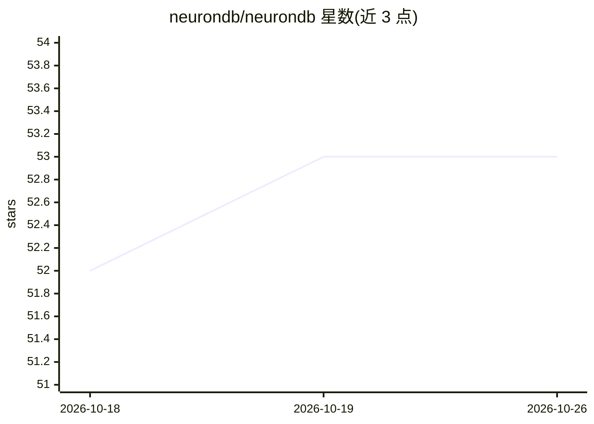

# neurondb/neurondb

⭐ 53 · C · NOASSERTION · 推送 2026-05-04 · [GitHub](https://github.com/neurondb/neurondb) · [官网](https://www.neurondb.ai) · 组织维护

**PostgreSQL 扩展：在库内做向量检索、kNN、ML 训练预测与混合搜索**

以单个 PostgreSQL 扩展形式提供向量类型（8 种）、HNSW/IVFFlat 索引、kNN 相似度检索、混合全文+向量搜索，以及 25+ 算法族的 SQL 内训练/预测/评估（XGBoost、LightGBM、K-Means 等），并覆盖嵌入生成、ONNX 推理、重排序与端到端 RAG 组件。数据保留在业务库内，复用 Postgres 备份、HA 与安全机制，通过 CREATE EXTENSION 安装，docker compose 可 5 分钟启动。GPU 加速（CUDA/ROCm/Metal）仅用于距离与搜索，索引构建仅 CPU；采用专有许可，兼容 PostgreSQL 16-18。

## 筛选速览

| 维度 | 判定 | 备注 |
|---|---|---|
| AI 角色 | `ai-native` | 本体是模型或模型工具 |
| 许可风险 | `none` | NOASSERTION |
| 部署形态 | `self-host` | docker 或自建部署 |
| 模型依赖 | — | README 未给出锁定关系 |
| 硬件要求 | — | 无带数字的原话,不猜 |
| 安装摩擦 | `low` | 无编译、无系统依赖或容器化 |
| 成熟度 | — | 结构信号不足 |

## 能力要点

- 8 种向量类型与 HNSW/IVFFlat 索引、多种距离度量
- 25+ 算法族在 SQL 内训练/预测/评估（XGBoost、LightGBM、CatBoost 等）
- 混合全文+向量搜索与端到端 RAG、重排序组件
- GPU 加速支持 CUDA/ROCm/Metal，含异步作业等后台 worker

## 适用场景

- 在现有 PostgreSQL 库内直接做向量相似度检索与混合搜索
- 不迁移数据地在业务表上训练和执行 ML 模型
- 在数据库层组装 RAG 与重排序流水线

## 场景标签

`向量数据库` `语义搜索` · 领域:知识与检索

## 证据(README 行号)

> L3: **PostgreSQL extension for vector similarity search (HNSW, IVFFlat), kNN, embeddings, machine learning, and hybrid f
> L41: |**ML**|25+ algorithm families (train/predict/evaluate): linear regression, XGBoost, LightGBM, CatBoost, K-Means, e
> L106: - **Embedding Generation** - Text, image, multimodal embeddings

## 星数曲线

2026-10-18 52 → 2026-10-26 53（+1）

---
*卡片 v1 · prompt 1.4 · 生成 2026-10-24 · 置信度 high · 依据 README sha `098f329d3de6` · [字段定义](../../DATASET.md)*
