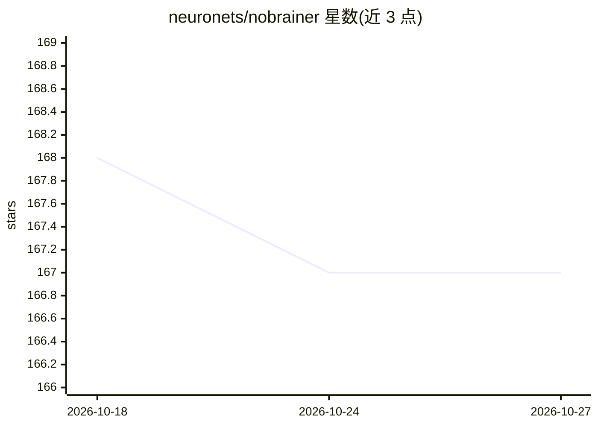

# neuronets/nobrainer

⭐ 167 · Python · NOASSERTION · 推送 2026-04-14 · [GitHub](https://github.com/neuronets/nobrainer) · 组织维护

**3D 脑图像深度学习框架：分割/生成/贝叶斯建模**

基于 PyTorch 与 MONAI 构建的 3D 脑图像处理深度学习框架，面向神经影像研究者与开发者。提供 6 种分割模型（UNet/VNet/Attention U-Net/UNETR/MeshNet/HighResNet）、Pyro 贝叶斯模型（不确定性量化）、GAN 生成模型与自监督学习组件；含 MONAI 数据管线、Zarr v3 转换、块级预测、CLI 推理命令及 LLM 驱动的自动超参搜索循环。支持 pip/uv 安装与 GPU/CPU Docker 镜像，预训练模型单独存放于 trained-models 仓库，项目由 NIH 资助、Apache 2.0 许可。

## 筛选速览

| 维度 | 判定 | 备注 |
|---|---|---|
| AI 角色 | `ai-native` | 本体是模型或模型工具 |
| 许可风险 | `none` | NOASSERTION |
| 部署形态 | `self-host` | docker 或自建部署 |
| 模型依赖 | — | README 未给出锁定关系 |
| 硬件要求 | `cpu-ok` | |
| 安装摩擦 | `low` | 无编译、无系统依赖或容器化 |
| 成熟度 | — | 结构信号不足 |

## 能力要点

- 分割/贝叶斯（不确定性量化）/生成三类模型与 MONAI 数据管线
- 块级预测与不确定性图（predict_with_uncertainty）
- CLI 工具：predict、generate、research（自动超参搜索）
- Zarr v3 多分辨率金字塔数据管道与 Croissant-ML 模型元数据

## 适用场景

- 对 T1w 脑影像做脑提取与分割并输出不确定性图
- 训练或微调 3D 医学图像分割模型
- 生成合成脑影像数据
- 过夜自动超参搜索并用 DataLad 版本化模型

## 场景标签

`目标检测` `微调` `图像生成` · 领域:内容生成

## 证据(README 行号)

> L5: _Nobrainer_ is a deep learning framework for 3D brain image processing built on
> L6: **PyTorch** and **MONAI**. It provides segmentation models (deterministic and
> L7: Bayesian), generative models, a MONAI-native data pipeline, block-based

## 星数曲线

2026-10-18 168 → 2026-10-27 167（-1）

---
*卡片 v1 · prompt 1.4 · 生成 2026-10-22 · 置信度 high · 依据 README sha `f026155a2cc7` · [字段定义](../../DATASET.md)*
