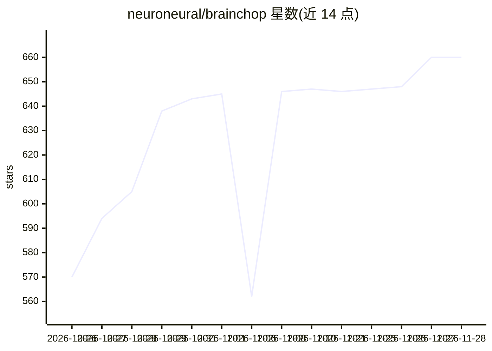

# neuroneural/brainchop

⭐ 660 · JavaScript · MIT · 推送 2026-11-27 · [GitHub](https://github.com/neuroneural/brainchop) · [官网](https://brainchop.org) · 组织维护

**浏览器内本地运行的 3D MRI 脑部分割与渲染工具**

BrainChop 通过 @brainchop/core 在用户设备上运行 3D MeshNet 体积分割，提供颅骨剥离与脑区分割，后端依次为 WebGPU V4（低内存模式）、WebGL2 回退与多线程 WebAssembly CPU 回退，并用 NiiVue 渲染多平面与 3D 视图；数据不离开设备且不加载客户端分析脚本。提供 mindgrab/mindmap/mindsnap 等多个模型，支持 URL 参数指定模型与计算后端，通过 npm 构建与 Playwright E2E 测试。声明仅限研究教育用途，非临床诊断医疗器械。

## 筛选速览

| 维度 | 判定 | 备注 |
|---|---|---|
| AI 角色 | `ai-native` | 本体是模型或模型工具 |
| 许可风险 | `permissive` | MIT |
| 部署形态 | `library` | 以包/库形式分发 |
| 模型依赖 | — | README 未给出锁定关系 |
| 硬件要求 | — | 无带数字的原话,不猜 |
| 安装摩擦 | `low` | 无编译、无系统依赖或容器化 |
| 成熟度 | — | 结构信号不足 |

## 能力要点

- 纯 JS WebGPU V4 引擎，含 WebGL2 与多线程 WASM CPU 回退
- 多模型分割：颅骨剥离、18 类皮质下/组织、104 区 Desikan-Killiany 图谱
- 扫描数据不离开设备，零客户端分析脚本
- URL 参数指定模型、后端与预处理选项

## 适用场景

- 在浏览器中对 3D 脑部 MRI 做颅骨剥离与分割
- 在无数据外传要求的本地环境中做神经影像分析
- 科研教学中的脑区皮层分割演示

## 场景标签

`科研工具` `目标检测` · 领域:学习与行业

## 证据(README 行号)

> L7:  Local, privacy-first 3D MRI brain segmentation and skull stripping in the browser.
> L17: BrainChop runs 3D MeshNet volumetric segmentation entirely on the user's device via `@brainchop/core` (pure-JS WebG

## 星数曲线

2026-10-26 570 → 2026-11-28 660（+90）

---
*卡片 v1 · prompt 1.4 · 生成 2026-11-28 · 置信度 high · 依据 README sha `7dcf3931f1d1` · [字段定义](../../DATASET.md)*
