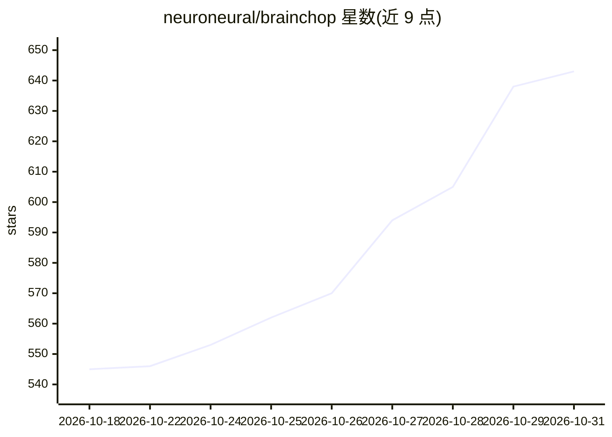

# neuroneural/brainchop

⭐ 643 · JavaScript · MIT · 推送 2026-02-24 · [GitHub](https://github.com/neuroneural/brainchop) · [官网](https://neuroneural.github.io/brainchop/) · 组织维护

**浏览器内 3D MRI 体积分割与渲染的纯前端工具**

面向神经影像的纯 JavaScript 开源前端应用：在网页浏览器端运行轻量深度学习模型（如 MeshNet，基于 TensorFlow.js）对 3D MRI 做体积分割，推理在用户本地浏览器侧完成，集成 NiiVue 查看器实现 MRI 可视化与 3D 渲染。提供网页端到端分割方案与 Colab 上的 MeshNet 训练/模型转换示例，相关论文发表于 JOSS（2023）。由学术作者开发，受 NIH/NSF 资助。

## 筛选速览

| 维度 | 判定 | 备注 |
|---|---|---|
| AI 角色 | `ai-native` | 本体是模型或模型工具 |
| 许可风险 | `permissive` | MIT |
| 部署形态 | `None` |  |
| 模型依赖 | — | README 未给出锁定关系 |
| 硬件要求 | — | 无带数字的原话,不猜 |
| 安装摩擦 | `low` | 无编译、无系统依赖或容器化 |
| 成熟度 | — | 结构信号不足 |

## 能力要点

- 浏览器端运行 MeshNet 等轻量模型做 MRI 分割推理
- 集成 NiiVue 查看器，支持 MRI 与分割结果 3D 渲染
- 提供 Colab 的 MeshNet 训练与 tfjs 模型转换示例
- 论文发表于 JOSS，v2.2.0 被 ISBI 2024 接收

## 适用场景

- 无需本地安装环境，在浏览器中直接做 3D MRI 分割
- 神经影像研究中快速可视化和分割 NIfTI 格式 MRI 数据
- 复现或扩展 MeshNet 模型的训练与浏览器部署

## 场景标签

`目标检测` `图像视频处理` · 领域:感知与多模态

## 证据(README 行号)

> L11:  Brainchop brings automatic 3D MRI volumetric segmentation capability to neuroimaging by running a lightweight deep
> L13:  We make the implementation of brainchop freely available, releasing its pure javascript code as open-source. The u

## 星数曲线

2026-10-18 545 → 2026-10-31 643（+98）

---
*卡片 v1 · prompt 1.4 · 生成 2026-10-21 · 置信度 high · 依据 README sha `280afeb981c9` · [字段定义](../../DATASET.md)*
