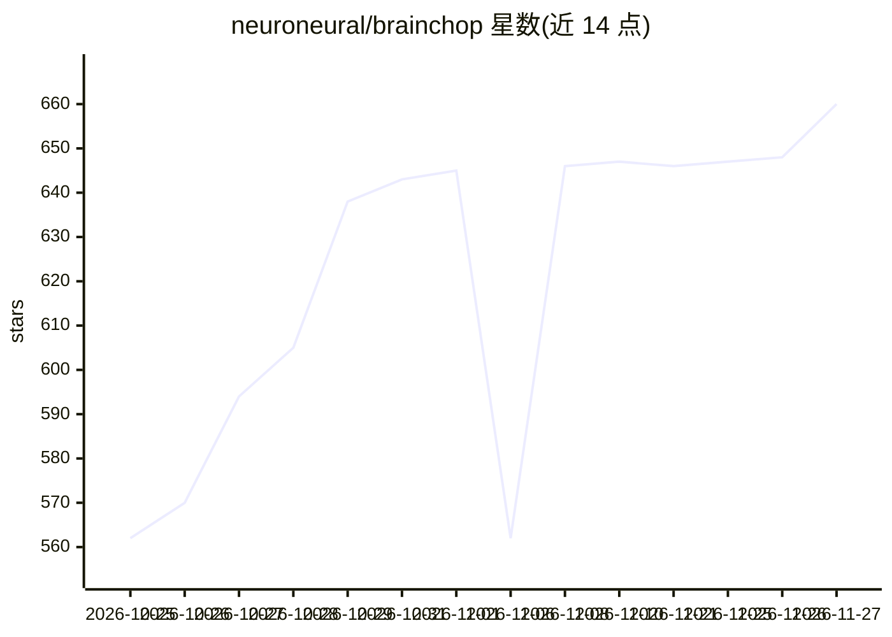

# neuroneural/brainchop

⭐ 660 · JavaScript · MIT · 推送 2026-11-25 · [GitHub](https://github.com/neuroneural/brainchop) · [官网](https://brainchop.org) · 组织维护

**浏览器端本地 3D MRI 脑部分割与渲染工具**

BrainChop 在用户设备上通过 @brainchop/core（纯 JS WebGPU 引擎，含低内存分阶段、WebGL2 回退与多线程 WebAssembly CPU 回退）运行 3D MeshNet 体积分割，并配合 NiiVue 渲染多平面与 3D 视图。提供多个模型：多模态颅骨剥离、18 类皮层下与组织分割、GM/WM/CSF 部分体积估计（实验性）、104 区 Desikan-Killiany 分割。数据不离开设备，无客户端分析脚本。声明仅供研究教育用途，未作为临床诊断医疗器械获批。开发提供 npm 命令与 Playwright E2E 测试。

## 筛选速览

| 维度 | 判定 | 备注 |
|---|---|---|
| AI 角色 | `ai-native` | 本体是模型或模型工具 |
| 许可风险 | `permissive` | MIT |
| 部署形态 | `library` | 以包/库形式分发 |
| 模型依赖 | — | README 未给出锁定关系 |
| 硬件要求 | — | 无带数字的原话,不猜 |
| 安装摩擦 | `low` | 无编译、无系统依赖或容器化 |
| 成熟度 | — | 结构信号不足 |

## 能力要点

- 在浏览器端运行 3D MeshNet 体积分割，数据不离开设备
- WebGPU 引擎附 WebGL2 回退与多线程 WebAssembly CPU 回退
- 支持 5 个模型：mindgrab 颅骨剥离、mindmap/mindsnap/mindmap-fast 分割等
- 提供 URL 参数强制指定模型与计算后端

## 适用场景

- 在浏览器中对 MRI 脑部图像做分割与颅骨剥离
- 生成 GM/WM/CSF 组织概率图与脑区标注
- 本地环境下处理敏感神经影像数据

## 场景标签

`目标检测` · 领域:感知与多模态

## 证据(README 行号)

> L7:  Local, privacy-first 3D MRI brain segmentation and skull stripping in the browser.
> L15: BrainChop runs 3D MeshNet volumetric segmentation entirely on the user's device via `@brainchop/core` (pure-JS WebG

## 星数曲线

2026-10-25 562 → 2026-11-27 660（+98）

---
*卡片 v1 · prompt 1.4 · 生成 2026-11-26 · 置信度 high · 依据 README sha `179e0e3f1a43` · [字段定义](../../DATASET.md)*
