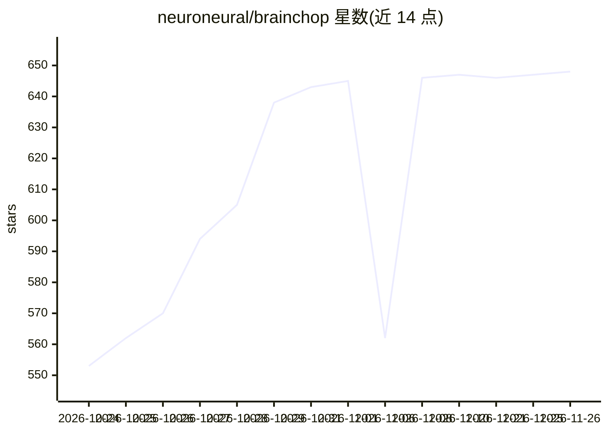

# neuroneural/brainchop

⭐ 648 · JavaScript · MIT · 推送 2026-11-25 · [GitHub](https://github.com/neuroneural/brainchop) · [官网](https://brainchop.org) · 组织维护

**浏览器本地运行的 3D MRI 脑部分割与渲染工具**

BrainChop 在用户设备上以纯 JS 方式运行 3D MeshNet 体积分割，通过 WebGPU、WebGL2 与多线程 WebAssembly CPU 三级后端回退适配不同环境，并使用 NiiVue 渲染多平面与 3D 视图。扫描数据不离开设备，且不加载客户端分析脚本。提供颅骨剥离、皮层下分区、组织概率图等多个模型，含 CLI 与 Python 形式；README 注明仅面向科研与教学用途，未作为医疗器械获批用于临床诊断。开发侧提供 npm 脚本与 Playwright 端到端测试。

## 筛选速览

| 维度 | 判定 | 备注 |
|---|---|---|
| AI 角色 | `ai-native` | 本体是模型或模型工具 |
| 许可风险 | `permissive` | MIT |
| 部署形态 | `library` | 以包/库形式分发 |
| 模型依赖 | — | README 未给出锁定关系 |
| 硬件要求 | — | 无带数字的原话,不猜 |
| 安装摩擦 | `low` | 无编译、无系统依赖或容器化 |
| 成熟度 | — | 结构信号不足 |

## 能力要点

- 纯 JS WebGPU 优先，WebGL2 与多线程 WASM CPU 自动回退
- 数据不离开设备，零客户端分析脚本
- 支持多模态颅骨剥离与 18/104 类分区等多个模型
- URL 参数可指定模型、计算后端与内存模式

## 适用场景

- 在浏览器中本地分割 MRI 脑部影像并做颅骨剥离
- 神经影像研究中的皮层与皮层下分区
- 教学场景演示 3D MRI 渲染与分割流程

## 场景标签

`科研工具` `目标检测` · 领域:学习与行业

## 证据(README 行号)

> L7:  Local, privacy-first 3D MRI brain segmentation and skull stripping in the browser.
> L14: BrainChop runs 3D MeshNet volumetric segmentation entirely on the user's device via `@brainchop/core` (pure-JS WebG

## 星数曲线

2026-10-24 553 → 2026-11-26 648（+95）

---
*卡片 v1 · prompt 1.4 · 生成 2026-11-25 · 置信度 high · 依据 README sha `d0ae4f6c5934` · [字段定义](../../DATASET.md)*
