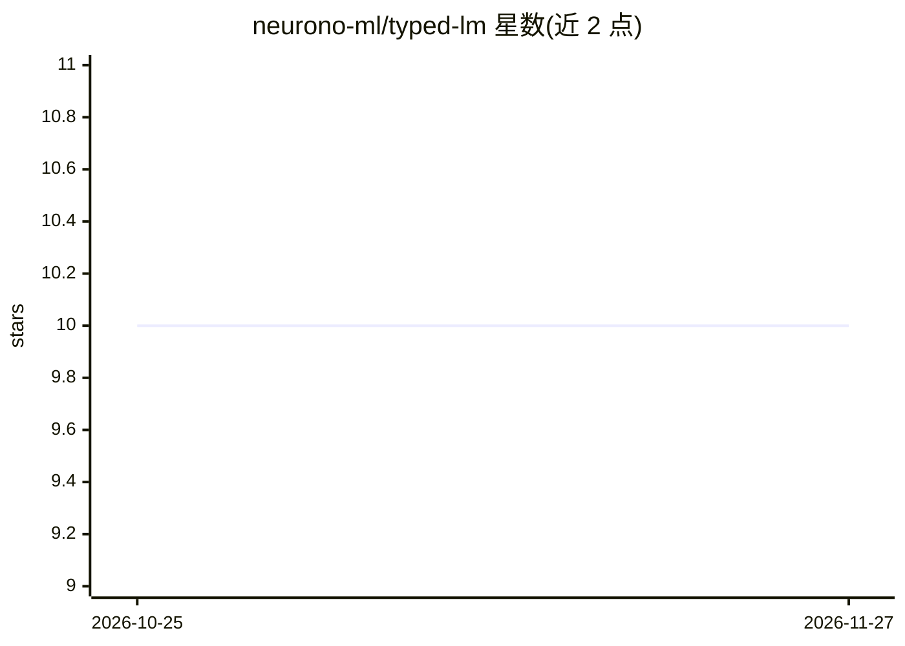

# neurono-ml/typed-lm

⭐ 10 · Rust · Apache-2.0 · 推送 2026-09-25 · [GitHub](https://github.com/neurono-ml/typed-lm) · [官网](https://neurono-ml.github.io/typed-lm/) · 个人维护

**将稠密 LLM 转为单次前向类型化决策 API 的 Rust 推理与训练工具**

typed-lm 是 Rust 编写的语义路由服务：将 Llama、Qwen2/Qwen3、Mistral、Gemma 系列稠密模型封装为返回布尔值、选项与分数的类型化 API，不做文本生成与解析。请求内所有问题共享一次 prefill 并批量求值，按决策位置读取 logits 输出带分布的类型化结果。内置 trainer 支持 LoRA/QLoRA/全量/从零训练，目标函数与推理读取位置一致；支持 FP8/FP4 量化。经 cargo、crates.io、Docker 镜像及预编译二进制分发，GPU 依赖 CUDA 或 Metal 特性。

## 筛选速览

| 维度 | 判定 | 备注 |
|---|---|---|
| AI 角色 | `ai-ecosystem` | LLM/agent 周边工具 |
| 许可风险 | `permissive` | Apache-2.0 |
| 部署形态 | `self-host` | docker 或自建部署 |
| 模型依赖 | local-ok | 支持本地模型 |
| 硬件要求 | — | 无带数字的原话,不猜 |
| 安装摩擦 | `low` | 无编译、无系统依赖或容器化 |
| 成熟度 | — | 结构信号不足 |

## 能力要点

- 每次请求单次前向：共享 prefill 加批量 question 后缀，延迟随前缀长度而非问题数增长
- 三类问题原语（noul/choice/score）可在同一请求组合
- LoRA/QLoRA/全量/从零训练与 FP8/FP4 PTQ，训练损失与推理决策位置一致
- Jev（TypeSafe AI）契约兼容，支持 GGUF Q4_K_M（Qwen2）

## 适用场景

- 为业务流程提供可分支判断的布尔/选项/分数决策接口
- 用自己的标注数据低成本专门化稠密模型（LoRA/QLoRA）
- 毫秒级低延迟场景下的文本语义路由服务
- CPU 环境用 GGUF 量化模型配合 MKL 加速推理

## 场景标签

`微调` `模型量化` `推理引擎` · 领域:训练与推理

## 证据(README 行号)

> L8: Gemma2 and Gemma3 — into a typed semantic-routing API. Send a *state* and typed
> L118: typed-lm is not just an inference server — it ships a **trainer** that turns a
> L164: The fastest path — no toolchain, just an image. The server image pulls the model

## 星数曲线

2026-10-25 10 → 2026-11-27 10（+0）

---
*卡片 v1 · prompt 1.4 · 生成 2026-11-19 · 置信度 high · 依据 README sha `1c9fd6b12693` · [字段定义](../../DATASET.md)*
