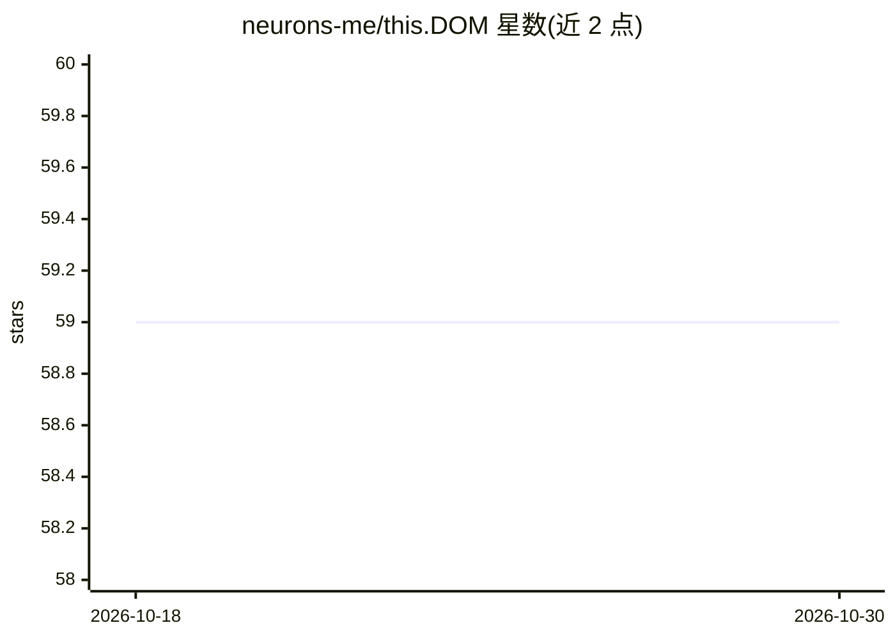

# neurons-me/this.DOM

⭐ 59 · HTML · MIT · 推送 2026-04-17 · [GitHub](https://github.com/neurons-me/this.DOM) · [官网](https://neurons-me.github.io/this.DOM/) · 组织维护

**网页 DOM 标准化处理库，为 neurons.me 生态输出结构化数据**

this.DOM 是 neurons.me 生态中的数据格式化工具：读取完整网页的 DOM，进行标准化处理，输出结构就绪的版本，以配合 neurons.me 的标准化数据格式。功能包括解析 HTML 文档、读取/操作/生成 DOM 结构，提供元素增删改等基础 DOM 操作 API。定位是数据格式化链路中的一环，供需要在应用中集成 DOM 处理的开发者使用。README 信息有限，未给出安装命令与运行示例。

## 筛选速览

| 维度 | 判定 | 备注 |
|---|---|---|
| AI 角色 | `ai-ecosystem` | LLM/agent 周边工具 |
| 许可风险 | `permissive` | MIT |
| 部署形态 | `None` |  |
| 模型依赖 | — | README 未给出锁定关系 |
| 硬件要求 | — | 无带数字的原话,不猜 |
| 安装摩擦 | `low` | 无编译、无系统依赖或容器化 |
| 成熟度 | — | 结构信号不足 |

## 能力要点

- 捕获并标准化网页完整 DOM
- 解析 HTML 文档、提取信息、操作元素
- 提供元素增删改等基础 DOM 操作 API
- 输出适配 neurons.me 标准化格式的结构化数据

## 适用场景

- 在应用中对网页 DOM 做标准化结构化处理
- 为 neurons.me 生态准备结构就绪的 DOM 数据
- 通过 API 完成 DOM 元素的增删改操作

## 场景标签

`文档解析` · 领域:知识与检索

## 证据(README 行号)

> L4: > **this.dom** takes a complete web page's **DOM**, standardizes it, and outputs a version that is structured ready.
> L6: This approach promotes a consistent, modular, and intuitive usage pattern across our different **dataformatters**, m

## 星数曲线

2026-10-18 59 → 2026-10-30 59（+0）

---
*卡片 v1 · prompt 1.4 · 生成 2026-10-24 · 置信度 low · 依据 README sha `aa2a6575c9af` · [字段定义](../../DATASET.md)*
